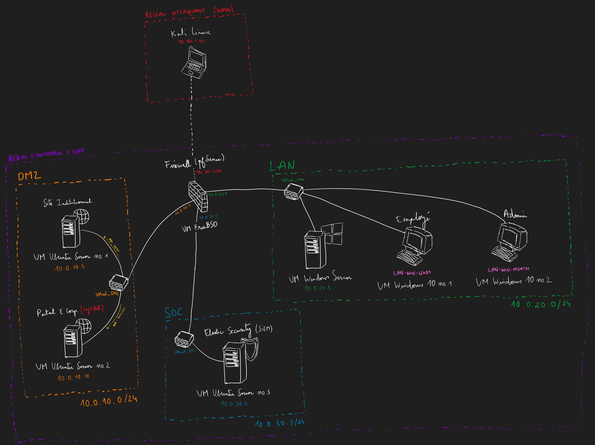

# E Corp Purple Team Lab

## But du projet et philosophie

Le **E Corp Purple Team Lab** est un environnement d'entreprise virtualisé (homelab) conçu par ingénierie inverse à partir de scénarios de cyberattaques réalistes. 

Contrairement aux environnements de type "Capture The Flag" (CTF) traditionnels qui se concentrent uniquement sur l'exploitation de failles isolées, ce laboratoire adopte une approche **Purple Team**. Le cœur absolu de ce projet réside dans l'exécution d'une **kill chain complète et documentée**. L'objectif est de dérouler cette compromission totale (Red Team) pour en étudier méticuleusement l'empreinte sur le réseau et les systèmes, afin de construire et d'évaluer une défense robuste (Blue Team).



### L'intérêt de la démarche
-   **Le cœur du projet (Red Team) :** D'une simple vulnérabilité web oubliée en DMZ jusqu'à la compromission absolue d'un parc Active Directory, le projet détaille l'exécution d'une kill chain réaliste de bout en bout (Log4Shell, tunneling, kerberoasting, mouvement latéral fileless, Golden Ticket et déploiement de ransomware), rigoureusement cartographiée selon le framework MITRE ATT&CK.
-   **Detection engineering (Blue Team) :** Mise en place d'un SOC moderne (Elastic SIEM, Suricata, Sysmon) pour assurer la détection et l'investigation des attaques (DFIR), analyser les limites de la télémétrie (angles morts, chiffrement) et proposer un plan de remédiation architectural robuste en réponse directe à la kill chain.
-   **Réalisme de l'infrastructure :** Le lab simule volontairement les compromis et la dette technique d'une véritable entreprise pour justifier la surface d'attaque : application "legacy" en DMZ exposée, comptes de services AD permissifs, et administration centralisée.

---

## Structure du dépôt

Le projet est divisé en trois sections majeures.

```text
ecorp-purple-team-lab/
├── 🛡️ blue-team-and-defense/                      # Analyse SOC, Forensics et Remédiation
│   ├── 01-detection-coverage-matrix.md
│   ├── 02-network-intrusion-detection.md
│   ├── 03-endpoint-and-ad-telemetry.md
│   ├── 04-remediation-and-hardening.md
│   └── README.md
│
├── 🏗️ infrastructure-and-context/                 # Architecture, Réseau et Build du Lab
│   ├── 01-network-and-routing-architecture.md
│   ├── 02-systems-and-attack-surface.md
│   ├── 03-soc-and-telemetry-deployment.md
│   ├── 04-troubleshooting-and-lessons-learned.md
│   └── README.md
│
├── ⚔️ red-team-kill-chain/                        # Exécution de l'Attaque (Phases 1 à 5)
│   ├── 01-initial-access-log4shell.md
│   ├── 02-internal-recon-and-trojan.md
│   ├── 03-ad-enum-and-kerberoasting.md
│   ├── 04-lateral-movement-and-lsass.md
│   ├── 05-domain-takeover-and-impact.md
│   └── README.md
│
├── 📦 lab-resources/                              # Scripts, exploits et sources de l'application
└── 🖼️ images/                                     # Captures d'écran et schéma d'architecture
```

> **Ordre de lecture recommandé :**
> 1. **La menace (cœur du projet) :** Suivez l'exécution de la kill chain pas-à-pas dans la section [Red Team](./red-team-kill-chain/README.md).
> 2. **La défense :** Analysez comment le SOC détecte (ou manque) ces intrusions dans la section [Blue Team](./blue-team-and-defense/README.md).
> 3. **Les fondations :** Découvrez comment l'environnement a été techniquement configuré dans la section [Infrastructure](./infrastructure-and-context/README.md).

---

## Stack technique

-   **Réseau et hyperviseur :** VMware Workstation Pro, pfSense 2.8.1
-   **Systèmes cibles :** Windows Server 2022 Standard Evaluation, Windows 10 Pro, Ubuntu Server 26.04
-   **Supervision (SOC) :** Elastic Security (ELK), Fleet, Elastic Agents, Suricata (NIDS), Syslog-ng
-   **Télémétrie et audit :** Sysmon (Olaf Hartong), Stratégies d'Audit Active Directory.
-   **Outils offensifs utilisés :** Burp Suite, Interactsh, marshalsec, jd-gui, Chisel, Proxychains, NetExec, Impacket, Hashcat, pypykatz, Evil-WinRM

---

## Pistes d'évolutions possibles

Bien que ce laboratoire présente une chaîne d'attaque et de défense déjà complète, une architecture d'entreprise offre de multiples possibilités d'ingénierie. Voici quelques axes d'amélioration théoriques qui pourraient enrichir une future itération de ce type d'infrastructure :

1. **Reverse proxy et déchargement SSL :** Intégration d'un reverse proxy (ex: Nginx ou HAProxy) en frontal de la DMZ avec déchargement SSL (SSL offloading). L'objectif défensif serait de permettre au NIDS (Suricata) d'inspecter le trafic HTTPS chiffré en clair avant son routage vers les serveurs applicatifs, afin de rendre l'infrastructure plus réaliste.
2. **Défense active (SOAR) :** Mise en place de webhooks entre Elastic SIEM et le pare-feu (ou les agents) pour implémenter des playbooks d'isolation automatique d'hôtes en cas de détection critique (ex: reverse shell).
3. **Télémétrie Linux avancée :** Déploiement d'outils comme Auditd ou de solutions EDR open-source sur les serveurs de la DMZ pour affiner la détection des processus malveillants, des rootkits et de la manipulation de services système.
4. **Automatisation de l'émulation d'adversaire :** Intégration d'un framework open-source de type Breach and Attack Simulation (ex: Atomic Red Team ou Caldera) pour rejouer automatiquement les TTPs de la kill chain et valider la résilience des règles de détection en continu.

---

## Avertissement légal / Legal disclaimer

> Ce projet est un environnement de recherche et de simulation strictement pédagogique. Il a été conçu de manière isolée pour étudier les mécanismes de détection (Blue Team) face aux menaces avancées persistantes (APT). L'ensemble des techniques offensives décrites ont été exécutées sur une infrastructure m'appartenant et avec mon consentement explicite. L'utilisation de ces techniques à l'encontre de systèmes sans autorisation préalable est illégale. L'auteur décline toute responsabilité quant à l'utilisation malveillante des informations contenues dans ce dépôt.