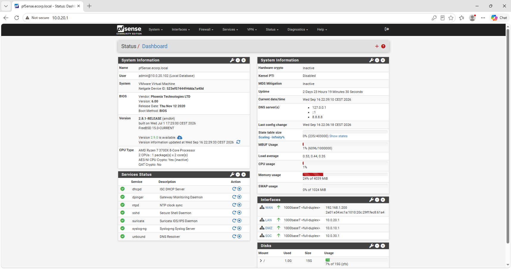
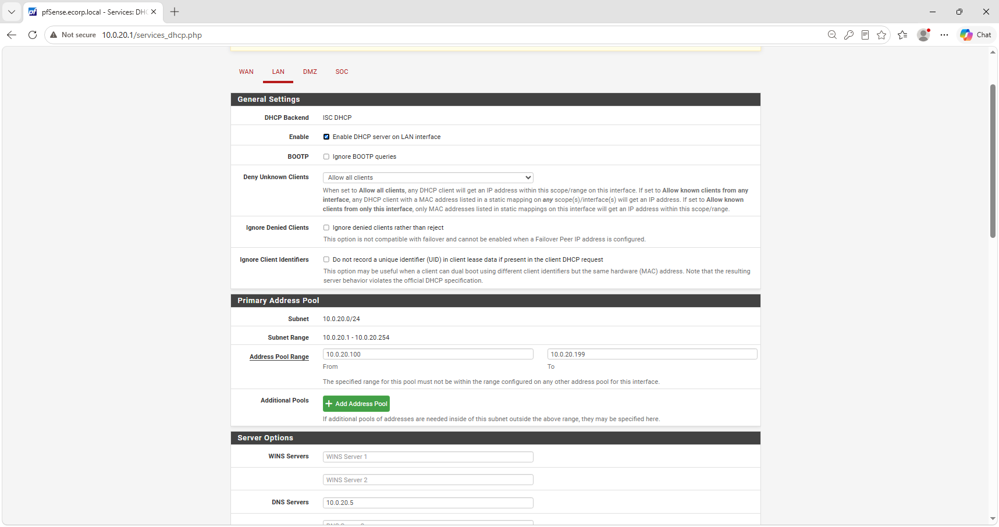

# 01 - Architecture réseau et routage

Ce document détaille la fondation de l'infrastructure de l'entreprise "E Corp". L'objectif est de reproduire fidèlement le cloisonnement d'un réseau d'entreprise moderne, tout en permettant les flux nécessaires à l'exécution de scénarios d'attaques réalistes (mouvements latéraux).

---

## 1. Cloisonnement de l'hyperviseur (VMware)

Pour garantir un isolement strict de l'environnement de test, le système de réseaux virtuels de VMware a été configuré avec trois commutateurs personnalisés (Custom VMnets) :

-   **ECorp_DMZ :** Héberge les serveurs web exposés.
-   **ECorp_LAN :** Héberge le cœur de réseau (Active Directory et postes clients).
-   **ECorp_SOC :** Héberge l'infrastructure de supervision.

> Pour chacun de ces réseaux virtuels, le service DHCP natif de VMware a été **désactivé**. L'hyperviseur n'attribue aucune adresse IP. L'adressage est géré soit statiquement au niveau des systèmes d'exploitation, soit dynamiquement par le pare-feu pfSense.

---

## 2. Plan d'adressage IP et topologie

Le réseau est divisé en quatre zones distinctes, interconnectées via une machine virtuelle pfSense (FreeBSD). L'adressage IP des serveurs Linux (DMZ, SOC) a été configuré statiquement au niveau de l'OS via **Netplan**, tandis que la machine de l'attaquant (Kali Linux) possède une IP fixe configurée manuellement sur son interface.

| Zone | Sous-réseau | Interface pfSense | Machines et Adresses IP |
| :--- | :--- | :--- | :--- |
| 🔴 **WAN** | `192.168.1.0/24` | `192.168.1.200` | **Kali Linux (Attaquant) :** `192.168.1.150` |
| 🟠 **DMZ** | `10.0.10.0/24` | `10.0.10.1` | **DMZ-LNX-CORP - Site institutionnel (Ubuntu Server) :** `10.0.10.5` **DMZ-LNX-PORTAL - Portail E Corp (Ubuntu Server) :** `10.0.10.10` |
| 🟢 **LAN** | `10.0.20.0/24` | `10.0.20.1` | **LAN-WIN-DC01 - Contrôleur de Domaine (Windows Server) :** `10.0.20.5` (IP Statique) **LAN-WIN-WK01 - Machine Employé(Windows 10) :** `10.0.20.100` (DHCP) **LAN-WIN-MGMT01 - Machine Admin (Windows 10) :** `10.0.20.102` (DHCP) |
| 🔵 **SOC** | `10.0.30.0/24` | `10.0.30.1` | **SOC-LNX-SIEM01 - Serveur Elastic Security (Ubuntu Server) :** `10.0.30.5` |

*Supervision pfSense : Vue d'ensemble du routage inter-zones et état des services de sécurité.*

---

## 3. Gestion DHCP et résolution DNS (LAN)

Pour les postes de travail clients du réseau LAN, pfSense agit en tant que serveur DHCP. Cette configuration permet de simuler le comportement dynamique des postes d'employés.

-   **Plage d'adresses (Pool) :** `10.0.20.100` à `10.0.20.199`. Cette plage préserve les premières adresses pour l'attribution statique des serveurs critiques (comme le Contrôleur de Domaine en `.5`).
-   **Serveur DNS :** Poussé dynamiquement via DHCP, il force les postes clients à interroger en priorité le Contrôleur de Domaine (`10.0.20.5`) pour la résolution DNS, permettant la jointure au domaine `ecorp.local`.

---

## 4. Cœur de réseau : routage et exposition

La configuration du pare-feu pfSense simule un environnement d'entreprise permissif en interne, vulnérable aux mouvements latéraux, tout en contrôlant strictement l'exposition vers l'extérieur.

### A. Routage inter-zones (firewall rules)
Contrairement à une architecture Zero-Trust stricte, le routage interne autorise la communication entre la DMZ et le LAN. 
-   **Vulnérabilité assumée (Pivoting) :** C'est cette permissivité réseau qui permet, lors d'une compromission applicative dans la DMZ, d'établir un tunnel réseau (SOCKS5/Chisel) pour interagir directement avec l'Active Directory sur le LAN.
-   **Télémétrie :** Les flux vers la zone SOC (`10.0.30.5`) sont explicitement autorisés depuis toutes les zones pour garantir la remontée des événements de sécurité vers le SIEM.

### B. Exposition externe (translation d'adresses - NAT)
Pour rendre les services web accessibles depuis le réseau de l'attaquant (WAN) sans exposer les serveurs directement, deux règles de Port Forwarding (NAT) ont été configurées sur l'interface publique de pfSense (`192.168.1.200`) :
1.  **Redirection HTTP (Site vitrine) :** Le trafic entrant sur le port **80** est redirigé vers le site institutionnel (`10.0.10.5`).
2.  **Redirection HTTP (Portail Web) :** Le trafic entrant ciblant l'application web métier (port **8443**) est redirigé vers le serveur vulnérable à Log4Shell (`10.0.10.10`).