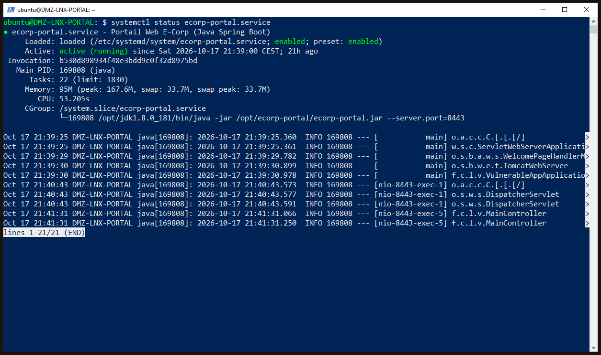
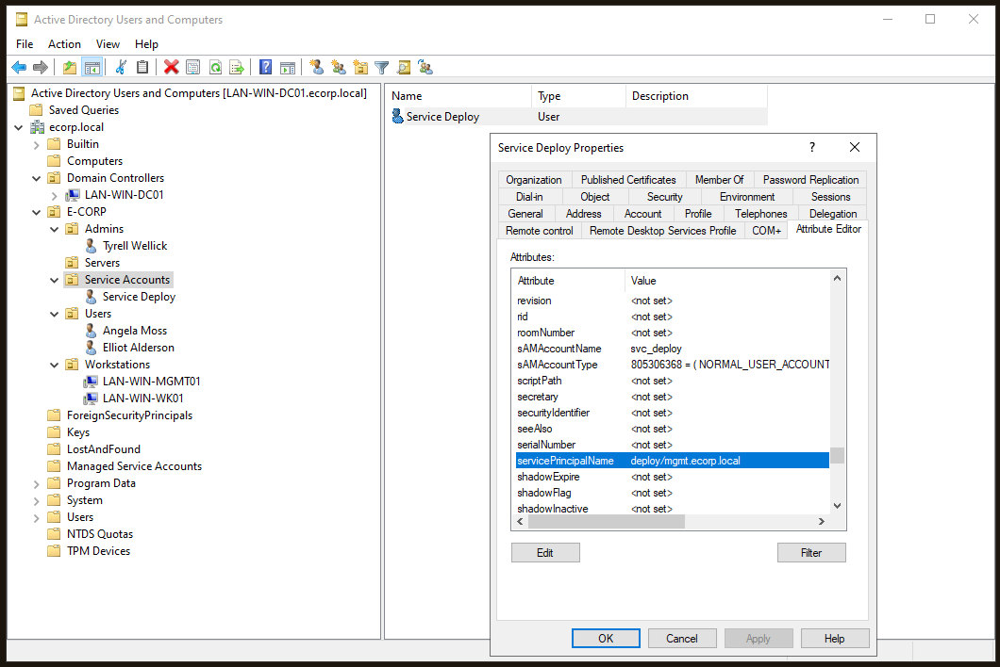
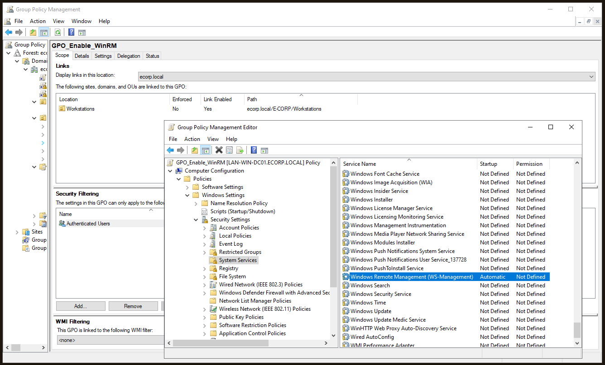

# 02 - Systèmes, scénario et surface d'attaque

Ce document détaille la configuration système des serveurs E Corp. Chaque décision architecturale a été pensée pour simuler les contraintes de production, les habitudes métier et la dette technique d'une entreprise réelle, justifiant ainsi la surface d'attaque qui sera exploitée lors de la phase Red Team.

## 1. Le "serveur oublié" : application métier en DMZ (CVE-2021-44228)

L'application web vulnérable à Log4Shell (`10.0.10.10`) constitue le point d'entrée de l'infrastructure. Pour simuler une ancienne application RH déployée fin 2021 que l'équipe IT n'ose plus mettre à jour, l'approche par conteneur a été écartée au profit d'un déploiement "Bare Metal" sur Ubuntu.

**Développement et customisation :**
-   **Base de code :** L'application repose sur le dépôt GitHub `christophetd/log4shell-vulnerable-app`.
-   **Customisation métier :** Pour coller au scénario visuel de l'entreprise, le `MainController` de l'application Spring Boot a été modifié afin d'y intégrer et de servir le front-end statique du portail E Corp (`index.html`). Les fichiers sources modifiés sont disponibles dans le répertoire `/lab-resources/vulnerable-web-portal/` du projet.
-   **Gestion par service système :** Pour garantir la disponibilité continue de cette application métier, l'équipe IT a encapsulé son exécution dans un service Linux natif (`ecorp-portal.service`). Cette configuration délègue la gestion de l'application à `systemd`, assurant son fonctionnement en arrière-plan et ordonnant son redémarrage automatique en cas de crash :

```ini
[Unit]
Description=Portail Web E Corp (Java Spring Boot)
After=network.target

[Service]
User=ecorp-web
Group=ecorp-web
WorkingDirectory=/opt/ecorp-portal
ExecStart=/opt/jdk1.8.0_181/bin/java -jar /opt/ecorp-portal/ecorp-portal.jar --server.port=8443
SuccessExitStatus=143
Restart=on-failure
RestartSec=10

[Install]
WantedBy=multi-user.target
```


<br>
*Vérification du statut "Active (running)" du service systemd gérant l'application vulnérable sur le serveur DMZ.*

**L'illusion de la sécurité et vulnérabilité :**
-   **Dette technique :** Le binaire final s'exécute sur un environnement Java obsolète (JDK 1.8.0_181) isolé dans `/opt/` et utilise la bibliothèque vulnérable Log4j 2.6.1, garantissant l'exploitabilité de l'injection JNDI (CVE-2021-44228).
-   **Hardening du système :** L'exécutable `.jar` est verrouillé en lecture et exécution stricte (`chmod 500`) et s'exécute sous le contexte d'un compte de service restreint (`ecorp-web`) dépourvu de droits `sudo`.
-   **La faille logique (hijacking du redémarrage) :** Bien que la configuration système semble robuste, une faille de conception fatale a été introduite. L'utilisateur `ecorp-web` restreint est le propriétaire légitime du fichier binaire. Un attaquant obtenant un accès initial via Log4Shell hérite des droits de cet utilisateur. Il peut ainsi s'octroyer de force les droits d'écriture sur le fichier (`chmod u+w`), écraser l'application légitime par une version "trojanisée" (incluant une fonction d'exfiltration d'identifiants), et tuer brutalement le processus (`kill -9`). La directive `Restart=on-failure` du service `systemd` se retourne alors contre le système : elle relance automatiquement le service, exécutant désormais la charge malveillante de l'attaquant.

## 2. L'Active Directory et la gestion des identités (LAN)

Le Contrôleur de Domaine (Windows Server 2022) centralise l'authentification du réseau. L'arborescence des Unités d'Organisation (OUs) a été structurée pour refléter la hiérarchie de l'entreprise. 

Voici un extrait de l'annuaire épuré des groupes par défaut, mettant en évidence les entités critiques du scénario et la séparation stricte des comptes de service :

```text
DC=ecorp,DC=local
├── OU=Domain Controllers
│   └── CN=LAN-WIN-DC01                 # Contrôleur de Domaine
├── CN=Users                            # Conteneur natif
│   ├── CN=Administrator                # Administrateur intégré (SID 500)
│   ├── CN=Guest                        # Compte invité
│   └── CN=krbtgt                       # Compte de service Kerberos
└── OU=E-CORP                           # Architecture métier
    ├── OU=Admins
    │   └── CN=Tyrell Wellick           # Administrateur (Domain Admin)
    ├── OU=Servers
    ├── OU=Service Accounts             # OU dédiée aux services
    │   └── CN=Service Deploy           # Compte de service (svc_deploy)
    ├── OU=Users
    │   ├── CN=Angela Moss              # Employée standard
    │   └── CN=Elliot Alderson          # Employé standard
    └── OU=Workstations
        ├── CN=LAN-WIN-MGMT01           # Machine d'administration
        └── CN=LAN-WIN-WK01             # Poste de travail standard
```

Pour rendre le laboratoire vivant et justifier les futurs vecteurs d'attaque, les profils ont été répartis en deux catégories distinctes :

### A. Les utilisateurs standards et privilégiés
-   **Les employés (standards) :** Elliot Alderson (`e.alderson`) et Angela Moss (`a.moss`) simulent les utilisateurs bureautiques classiques. Elliot travaille quotidiennement sur son poste client attitré (`LAN-WIN-WK01`).
-   **L'administrateur (privilégié) :** Tyrell Wellick (`t.wellick`) est membre du groupe restreint "Domain Admins". Il a l'habitude de se connecter régulièrement sur le serveur d'administration informatique (`LAN-WIN-MGMT01`) pour ses tâches de maintenance, laissant ainsi ses traces d'authentification en mémoire.

### B. Le compte de service (`svc_deploy`)
Ce compte simule un outil de déploiement logiciel automatisé (type SCCM ou PDQ Deploy). Ses caractéristiques techniques, qui en feront un vecteur de mouvement latéral critique, découlent directement des contraintes de production typiques :

-   **Isolation structurelle :** Afin de respecter les standards d'administration, une Unité d'Organisation dédiée (`Service Accounts`) a été spécifiquement créée pour héberger ce compte.
-   **Mot de passe faible et persistance :** Le mot de passe a été défini sur `Password123!`. Cela simule un mot de passe temporaire configuré lors du déploiement initial, que l'équipe IT n'a jamais modifié. L'option *Le mot de passe n'expire jamais* a été cochée pour éviter toute interruption de service.
-   **Exposition Kerberos (SPN) :** Pour vérifier si de nouveaux logiciels doivent être déployés, les agents des postes clients s'authentifient auprès du serveur central via Kerberos. Un attribut SPN (`deploy/mgmt.ecorp.local`) lui a donc été attribué, l'exposant volontairement à l'extraction de tickets (kerberoasting).


<br>
*Console ADUC illustrant la structure des OUs et l'exposition de l'attribut SPN (ServicePrincipalName) du compte de service, le rendant vulnérable à l'attaque kerberoasting.*

```powershell
# Provisioning du compte de service dans l'OU dédiée sur le Contrôleur de Domaine
New-ADUser -Name "Service Deploy" `
           -SamAccountName "svc_deploy" `
           -UserPrincipalName "svc_deploy@ecorp.local" `
           -Path "OU=Service Accounts,OU=E-CORP,DC=ecorp,DC=local" `
           -AccountPassword (ConvertTo-SecureString "Password123!" -AsPlainText -Force) `
           -Enabled $true `
           -PasswordNeverExpires $true

# Ajout du SPN pour activer l'authentification Kerberos
setspn -s deploy/mgmt.ecorp.local svc_deploy
```

-   **Privilèges locaux :** Il doit pouvoir installer des logiciels silencieusement. Il a donc été ajouté par script PowerShell au groupe *Administrateurs* de toutes les machines de l'OU `Workstations` (incluant `WK01` et `MGMT01`).

```powershell
# Récupération dynamique des postes clients et injection du compte dans le groupe Administrateurs local
$Targets = Get-ADComputer -SearchBase "OU=Workstations,OU=E-CORP,DC=ecorp,DC=local" -Filter * | Select-Object -ExpandProperty DNSHostName

Invoke-Command -ComputerName $Targets -ScriptBlock {
    Add-LocalGroupMember -Group "Administrators" -Member "ECORP\svc_deploy" -ErrorAction SilentlyContinue
}
```

## 3. Déploiement de l'administration à distance (WinRM)

Afin de simuler les standards modernes de gestion de parc informatique (remplaçant les anciens protocoles vieillissants), le protocole d'administration à distance WinRM a été activé sur l'ensemble du réseau Windows.

**Déploiement centralisé :** Une Stratégie de Groupe (`GPO_Enable_WinRM`) automatise le démarrage du service WS-Management et ouvre le port TCP 5985 dans le pare-feu Defender pour tous les postes. C'est ce standard d'administration légitime qui permettra structurellement les futurs mouvements latéraux de l'attaquant.


<br>
*Console de gestion des stratégies de groupe (GPMC) confirmant l'activation centralisée du service Windows Remote Management sur le parc client.*