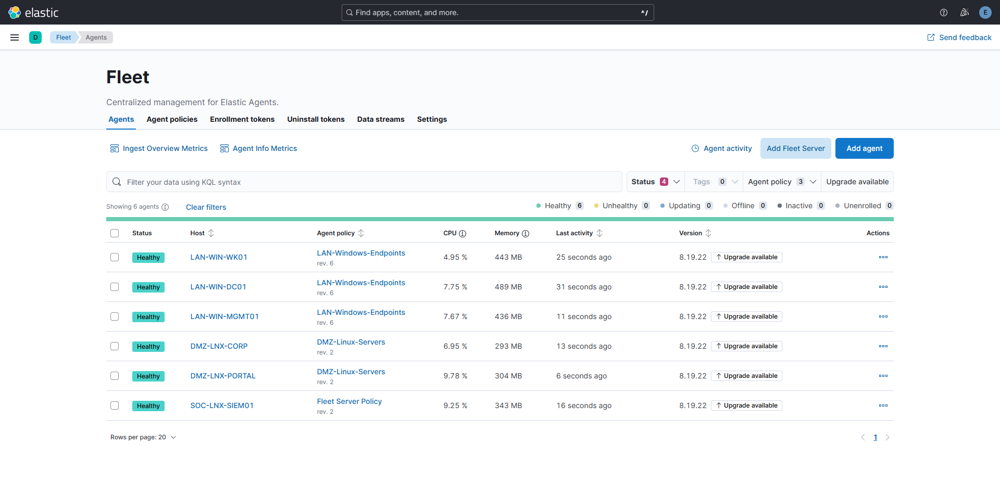
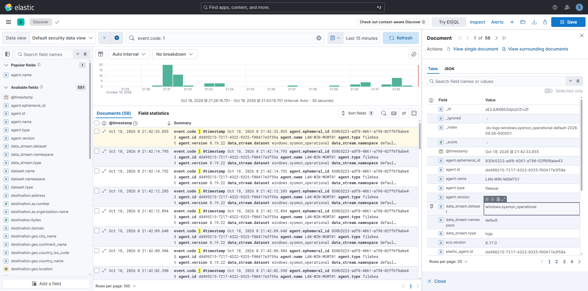

# 03 - Déploiement du SOC et de la télémétrie (Blue Team)

Ce document détaille la stratégie de supervision mise en place sur l'infrastructure "E Corp". L'objectif est de transformer un réseau standard en un environnement hautement surveillé, capable de capter les signaux faibles d'une attaque de type APT (Advanced Persistent Threat) à chaque étape de la Kill Chain.

La télémétrie est centralisée sur une stack **Elastic SIEM** (hébergée dans la zone SOC `10.0.30.5`), qui s'appuie sur une architecture "Elasticsearch -> Fleet Server -> Elastic Agents" pour agréger les journaux des Endpoints (Windows/Linux) et du réseau (pfSense/Suricata).

---

## 1. Déploiement universel des agents (log forwarding)

Afin de garantir une visibilité totale sur les environnements, l'agent Elastic a été déployé sur l'intégralité des machines du laboratoire avant toute configuration de détection avancée.

*Vue centralisée depuis Elastic Fleet confirmant le déploiement et l'état de santé ("Healthy") des agents sur l'ensemble du parc (DMZ, LAN et SOC).*

---

## 2. Télémétrie endpoint avancée (Windows et AD)

La supervision des postes Windows repose sur une combinaison stricte entre l'audit natif de l'OS et l'utilitaire Sysmon.

### A. Stratégie d'audit avancé (GPO)
Pour combler les angles morts de détection (notamment l'authentification réseau, les activités en mémoire et les altérations de l'annuaire), une stratégie de groupe dédiée (`GPO_SOC_Audit`) est déployée à la racine du domaine avec l'option **Enforced** pour garantir son application prioritaire et uniforme sur l'ensemble du parc.
-   **Forçage LSA et traçabilité des processus (Event 4688) :** Les sous-catégories d'audit avancé écrasent les stratégies héritées, et la journalisation des lignes de commande complètes est activée pour capturer l'ensemble des arguments passés aux utilitaires système et LOLBins (`quser`, `gpupdate`, `shutdown`).
-   **Surveillance PowerShell avancée (Events 4104, 4103) :** Activation conjointe du *Script Block Logging* (avec événements d'invocation) et du *Module Logging* étendu (`*`) pour reconstituer en clair le code exécuté dynamiquement en mémoire (scripts fileless, P/Invoke, compilations `Add-Type` et cmdlets du module `GroupPolicy`).
-   **Authentification Kerberos et NTLM (Events 4768, 4769, 4776) :** Journalisation stricte des demandes TGT et TGS pour détecter le Kerberoasting et l'usage de tickets forgés (Golden Ticket), complétée par l'audit de validation des informations d'identification pour intercepter les mouvements latéraux en Pass-the-Hash (NTLM).
-   **Surveillance et modifications de l'annuaire (Events 4662, 5136, 5137) :** Détection des requêtes de réplication non autorisées ciblant les contrôleurs de domaine (DCSync) et traçabilité immédiate de la création, de la modification ou de la liaison forcée d'objets GPO malveillants.
-   **Accès aux partages et intégrité des fichiers (Events 5140, 4663) :** Traçabilité des accès aux partages réseau (notamment les connexions SMB distantes et l'écriture de charges utiles dans `SYSVOL`), couplée à l'audit du système de fichiers pour surveiller les répertoires sensibles (dépôt d'un dump mémoire dans `Temp`).
-   **Détection des requêtes LDAP non sécurisées (Event 2889) :** Activation via le registre du niveau de diagnostic NTDS (`16 LDAP Interface Events = 2`) pour tracer les authentifications applicatives en Simple Bind LDAP transitant en clair.
-   **Résilience et conservation des preuves :** Extension de la capacité maximale du journal d'événements de sécurité à 1 Go afin de prémunir le SOC contre la saturation ou l'écrasement prématuré des événements lors d'actions massives sur le parc.

### B. Déploiement de Sysmon (Sysmon-Modular)
Afin d'obtenir une télémétrie granulaire sur les comportements d'attaque complexes, **Sysmon64** est déployé avec le profil de configuration **Sysmon-Modular d'Olaf Hartong** sur l'ensemble du parc Windows.
-   Mappage MITRE ATT&CK direct : Enrichit automatiquement les logs avec les identifiants de techniques offensives, accélérant le triage dans le SIEM.
-   Ratio signal/bruit maîtrisé : Filtrage fin du bruit système Windows pour optimiser la bande passante et réduire les coûts d'ingestion des logs.
-   Détection ciblée des menaces modernes : Visibilité accrue sur l'usage des LOLBins, l'injection de code, la persistance et les flux C2 (DNS).

*Interface Discover d'Elasticsearch illustrant l'ingestion réussie des journaux Sysmon (ici l'Event ID 1 : Process Creation) remontés par l'agent depuis la machine d'administration.*

### C. Moteur de détection
Dans le cadre de ce laboratoire, l'intégralité des **1900+ règles natives Elastic** a été activée. Cette approche maximise la surface de détection (Chalutage) et illustre l'efficacité de la corrélation entre les journaux bruts configurés en amont (Sysmon/Windows) et le déclenchement des alertes dans le SIEM.

---

## 4. Télémétrie périmétrique et NIDS (pfSense et Suricata)

La surveillance du trafic Nord-Sud et Est-Ouest est assurée par le système de détection d'intrusion (IDS) **Suricata** sur pfSense, générant des journaux au format **EVE JSON**. La chaîne de transmission nécessite une configuration conjointe entre le pare-feu et le serveur SIEM.

La transmission vers Elastic est assurée par un routage direct via **syslog-ng**, configuré dans le menu *Advanced* de pfSense avec des directives d'exportation strictes :
1.  **Source (`suricata_src`) :** Ciblage du fichier local avec la directive `flags(no-parse)` pour interdire au service d'altérer la structure JSON originelle.
2.  **Destination (`elastic_dst`) :** Transfert réseau en TCP vers le SIEM (`10.0.30.5`) sur le port d'écoute `5140`.
3.  **Log (Routage) :** Liaison de la source vers la destination (`{ source(suricata_src); destination(elastic_dst); };`).

Pour assurer une homogénéité technique, **syslog-ng** a également été déployé sur le SIEM pour intercepter le flux réseau.  La configuration de réception s'articule autour de directives miroirs pour préserver l'intégrité du payload JSON jusqu'à son écriture sur le disque dans un fichier local cible (`/var/log/suricata/eve.json`), où l'Agent Elastic viendra le collecter.

*Note : Les défis techniques liés à la troncation UDP et au formatage de ces logs sont détaillés dans le document de Troubleshooting.*

---

## 5. Normalisation et alertes personnalisées

Afin d'intégrer nativement les détections réseau Suricata directement dans la console "Alerts" d'Elastic Security tout en conservant une pondération exacte du risque, trois règles SIEM distinctes ont été créées en fonction du niveau de sévérité (High, Medium, Low).

-   **Requête de base (KQL) :** 
    `event.dataset: "suricata.eve" and suricata.eve.event_type: "alert" and event.severity: X` *(où X représente la sévérité ciblée).*
-   **Rule Name Override :** Pour que le tableau de bord affiche avec précision le nom exact de l'attaque détectée (ex: *ET EXPLOIT Log4j JNDI*), ce paramètre est mappé dynamiquement sur le champ natif `rule.name`.

Grâce à cette agrégation centralisée, Elastic Security devient l'unique point d'analyse, corrélant simultanément les intrusions réseau en DMZ et les mouvements latéraux internes sur le LAN, avec une remontée fidèle de la criticité de chaque événement.